# Formación Integral en Inteligencia Artificial
## De fundamentos a agentes y automatización avanzada: programa académico

> **Versión académica:** 1.2 · **Fecha de la versión:** 12/10/2026
> **Procedencia:** versión pública del programa académico 1.2 (revisión 4 del documento de origen). Solo se quitó o generalizó información personal o propia de la instancia de origen; contenidos, módulos, unidades, lecciones, IDs, tipos, prerrequisitos, horas y proyectos se conservan sin cambios. Detalle en la sección 10.
> **Público destinatario:** personas con experiencia en programación (idealmente backend: API REST, bases de datos, Python o Java) y sin conocimientos previos de IA.
> **Disponibilidad:** el programa completo es visible, pero no todas las lecciones tienen material desarrollado. Las desarrolladas tienen enlace (ver sección 6 y el estado de publicación en `README.md`).
> **Documentos relacionados:** `README.md` · `COMO-EMPEZAR.md` · `TUTOR.md` · `GLOSARIO.md` · cuaderno del estudiante (`plantillas/cuaderno-estudiante/`).
> **Licencia:** CC BY-SA 4.0 (ver `LICENSE`).

---

## Índice

1. Principios de diseño del programa
2. Dos niveles de aprendizaje: usar antes de construir
3. Mapa de aprendizaje y dependencias
4. Resumen de módulos y horas
5. Hilos transversales
6. Temario detallado (módulos 0 a 17)
7. Módulos electivos
8. Proyectos del curso
9. Sistema de evaluación y estados de aprendizaje
10. Versiones, procedencia y cambios
11. Perfil de egreso

---

## 1. Principios de diseño del programa

1. **Usar con criterio antes de construir.** Cada herramienta importante se aprende primero a usar y configurar (Nivel 1) y después a desarrollar (Nivel 2). Ver sección 2.
2. **Modelo mental antes que receta.** Incluso en Nivel 1 se explica qué resuelve cada herramienta, cómo funciona por dentro a nivel conceptual y cuándo no conviene. Así podés evaluar herramientas nuevas sin depender de tutoriales.
3. **Concepto general → implementación específica.** Cada tema separa lo transferible (por ejemplo, "tool calling") de cómo lo implementa cada plataforma (Claude, OpenAI, Gemini, Spring AI).
4. **Construir desde cero antes de usar frameworks.** En Nivel 2 construís un agente con un bucle propio antes de usar un SDK de agentes, y un servidor MCP con el SDK antes de usar abstracciones de alto nivel.
5. **Multiplataforma.** El curso no depende de ninguna plataforma: un tutor de IA es opcional y el contenido es independiente de él. Las herramientas principales de práctica son Claude y ChatGPT (asistentes), Claude Code y Codex (agentes de programación), con Gemini y modelos locales (Ollama) donde aportan valor. Se priorizan los estándares abiertos (MCP, Agent Skills, AGENTS.md, A2A, OpenTelemetry). Ninguna herramienta entra al temario solo por ser popular: cada una tiene una justificación pedagógica.
   - **Regla de ejercicios multiplataforma:** una actividad se repite en otra plataforma **solo** cuando la comparación enseña una diferencia técnica relevante (permisos, contexto, formato de configuración, costos). En los demás casos, las plataformas se **alternan** entre ejercicios y proyectos para no duplicar trabajo.
   - **Común vs. específico:** cada lección de herramientas separa lo común a todos los agentes o asistentes de lo propio de cada implementación. No se atribuye a una herramienta una función de otra sin verificarla en su documentación.
6. **Seguridad, evaluación y costos desde el inicio**, como hilos en todos los módulos.
7. **Python como lenguaje principal de laboratorio y Java como segundo lenguaje** en los módulos de integración (M6, M8 opcional, M10 y M14), por su presencia habitual en entornos empresariales.
8. **Gratis o barato por defecto.** Ollama, niveles gratuitos de API, n8n y pgvector autohospedados. Lo pago se avisa siempre.

---

## 2. Dos niveles de aprendizaje: usar antes de construir

| Herramienta o capacidad | Nivel 1: utilización y configuración | Nivel 2: desarrollo y profundización |
|---|---|---|
| Asistentes (Claude con capacidades de Cowork, ChatGPT con Work, Gemini) | **M3** | Base conceptual en M6, M7 y M9 |
| Proyectos, instrucciones, memoria y contexto | **M3** (como persona usuaria) | **M7** Context Engineering |
| Connectors y servidores MCP | **M3** (conectar y configurar existentes) | **M10** (construir servidores y clientes) |
| Skills y plugins | **M3** y **M4** (instalar, usar, evaluar, revisar) | **M11** (primera skill propia en el agente de programación) y **M12** (crear, empaquetar, distribuir) |
| Agentes de programación (**Claude Code y Codex**; Gemini CLI u OpenCode como opciones locales) | **M4** (uso guiado y configuración básica de ambos) | **M11** (arquitectura, permisos, MCP, skills, automatización y CI en ambos) |
| Automatización con n8n | **M5** (workflows deterministas) | **M13** (LLM, agentes, RAG y MCP en n8n) |
| Delegación de tareas complejas | **M3** y **M4** (especificar, supervisar, verificar) | **M9**, **M14** y **M15** (construir agentes que delegan) |
| Multimodalidad y agentes de computadora/navegador | **M3** (usar con criterio y seguridad) | Electiva **E1** (desarrollar) |

**Regla pedagógica:** un módulo de Nivel 2 empieza repasando en 15 minutos lo usado en Nivel 1 y después "abre la caja": cómo está construido, cómo construir un equivalente propio y cuándo conviene cada opción.

---

## 3. Mapa de aprendizaje y dependencias

**Tipos de prerrequisito:**
- **Duro** (flecha continua): conocimiento indispensable. Sin él, el módulo no se puede seguir.
- **Recomendado** (flecha punteada): mejora la experiencia, pero se puede avanzar sin él y retomarlo después.

```mermaid
flowchart TD
    M0[M0 Orientación y entorno] --> M1[M1 Fundamentos de IA generativa y LLM]
    M1 --> M2[M2 Prompt Engineering]
    M2 --> M3[M3 Asistentes de IA: uso profesional y delegación · N1]
    M2 --> M4[M4 Agentes de programación · N1]
    M0 --> M5[M5 Automatización con n8n: workflows deterministas · N1]
    M3 -.-> M4
    M2 -.-> M5
    M2 --> M6[M6 Desarrollo con APIs de modelos]
    M3 -.-> M6
    M6 --> M7[M7 Context Engineering]
    M3 -.-> M7
    M4 -.-> M7
    M6 --> M8[M8 Embeddings, búsqueda semántica y RAG]
    M7 --> M8
    M6 --> M9[M9 Agentes desde cero]
    M7 --> M9
    M8 -.-> M9
    M9 --> M10[M10 MCP: desarrollo · N2]
    M3 -.-> M10
    M4 --> M11[M11 Agentes de programación · N2]
    M7 --> M11
    M10 -.-> M11
    M11 --> M12[M12 Skills y plugins: desarrollo · N2]
    M3 --> M12
    M5 --> M13[M13 n8n con IA y agentes · N2]
    M6 --> M13
    M9 --> M13
    M8 -.-> M13
    M10 -.-> M13
    M9 --> M14[M14 Frameworks y SDK de agentes]
    M10 -.-> M14
    M14 --> M15[M15 Sistemas multiagente]
    M14 --> M16[M16 Seguridad, evaluación, observabilidad y operación]
    M13 --> M16
    M12 -.-> M16
    M15 -.-> M16
    M16 --> M17[M17 Proyecto final integrador]

    M3 --> E1[E1 Multimodalidad avanzada y agentes de computadora/navegador]
    M9 --> E1
    M1 --> E2[E2 Modelos abiertos, ejecución local y fine-tuning]
    M8 -.-> E2
    M3 --> E3[E3 Ética, marco legal y gobernanza]
```

**Bloques:**

- **Bloque I · Fundamentos y uso profesional (M0 a M5).** Cómo funciona un LLM, cómo darle instrucciones y cómo usar con criterio asistentes, agentes de programación y automatizaciones simples. Al terminar este bloque ya usás la IA profesionalmente todos los días.
- **Bloque II · Construir con modelos (M6 a M8).** API, gestión del contexto y RAG.
- **Bloque III · Agentes e interoperabilidad (M9 a M12).** Agentes desde cero, MCP, agentes de programación por dentro y desarrollo de skills y plugins.
- **Bloque IV · Automatización y sistemas avanzados (M13 a M15).** n8n con agentes, frameworks y multiagente.
- **Bloque V · Producción e integración (M16 y M17).**
- **Electivas (E1 a E3).** Se intercalan cuando se cumplen sus prerrequisitos duros.

**Flexibilidad del recorrido:**
- **M5 (n8n Nivel 1) solo exige M0.** Podés hacerlo en cualquier momento del Bloque I, incluso en paralelo con M1 a M4. Solo su última lección (primer nodo LLM) aprovecha M2.
- **M3 y M4 pueden cursarse en paralelo** después de M2.
- **M13 (n8n Nivel 2)** puede adelantarse antes de M10 a M12. Sus lecciones de RAG y MCP (L13.3.1 y L13.3.2) se pueden posponer hasta completar M8 y M10.
- **M15 (multiagente) y M16 (producción)** pueden cursarse en cualquier orden después de M14.
- Una dificultad en un módulo **solo bloquea los módulos que dependen de él con prerrequisito duro** (ver sección 9).

---

## 4. Resumen de módulos y horas

Las horas son estimaciones realistas para estudio autónomo con práctica real (no lectura pasiva). Incluyen ejercicios y proyectos.

| # | Módulo | Nivel | Lecciones | Teoría | Práctica | Total |
|---|---|:-:|---:|---:|---:|---:|
| M0 | Orientación, entorno y método | — | 4 | 2 | 4 | 6 |
| M1 | Fundamentos de IA generativa y LLM | — | 16 | 12 | 12 | 24 |
| M2 | Prompt Engineering | — | 15 | 8 | 12 | 20 |
| M3 | Asistentes de IA: uso profesional, contexto y delegación | N1 | 25 | 11 | 25 | 36 |
| M4 | Agentes de programación: uso guiado | N1 | 14 | 5 | 16 | 21 |
| M5 | Automatización con n8n: workflows deterministas | N1 | 11 | 5 | 13 | 18 |
| M6 | Desarrollo con APIs de modelos | — | 14 | 10 | 20 | 30 |
| M7 | Context Engineering | N2 | 11 | 8 | 12 | 20 |
| M8 | Embeddings, búsqueda semántica y RAG | — | 14 | 12 | 22 | 34 |
| M9 | Agentes desde cero | — | 13 | 12 | 18 | 30 |
| M10 | Model Context Protocol: desarrollo | N2 | 16 | 11 | 21 | 32 |
| M11 | Agentes de programación: arquitectura y configuración avanzada | N2 | 14 | 7 | 18 | 25 |
| M12 | Skills y plugins: desarrollo | N2 | 10 | 5 | 13 | 18 |
| M13 | n8n con IA y agentes | N2 | 10 | 7 | 17 | 24 |
| M14 | Frameworks y SDK de agentes para producción | — | 11 | 12 | 24 | 36 |
| M15 | Sistemas multiagente | — | 11 | 10 | 16 | 26 |
| M16 | Seguridad, evaluación, observabilidad y operación | — | 16 | 14 | 22 | 36 |
| M17 | Proyecto final integrador | — | 8 | 5 | 45 | 50 |
| | **Núcleo obligatorio** | | **233** | **156** | **330** | **486** |
| E1 | Multimodalidad avanzada y agentes de computadora/navegador | N2 | — | 4 | 8 | 12 |
| E2 | Modelos abiertos, ejecución local y fine-tuning | — | — | 8 | 14 | 22 |
| E3 | Ética, marco legal y gobernanza de IA | — | — | 5 | 1 | 6 |
| | **Total con electivas** | | | **173** | **353** | **526** |

Las electivas no tienen lecciones numeradas: su desglose se define al elegirlas.

**Margen realista:** sumá alrededor de un 10% para repasos espaciados, refuerzos y actualizaciones del ecosistema: **unas 580 horas** con electivas.

| Dedicación semanal | Núcleo (486 h) | Con electivas y margen (~580 h) |
|---|---|---|
| 6 h/semana | ~19 meses | ~22 meses |
| 10 h/semana | ~11 meses | ~13 meses |
| 15 h/semana | ~7,5 meses | ~9 meses |

---

## 5. Hilos transversales

| Hilo | Qué se trabaja en cada módulo |
|---|---|
| 🔒 **Seguridad y privacidad** | Qué datos entran al modelo, manejo de credenciales, permisos mínimos y amenazas específicas del tema. |
| 📏 **Evaluación** | Cómo saber si funciona: desde comparar resultados a mano (M2, M3) hasta suites de evals automatizadas (M16). |
| 💰 **Costos y rendimiento** | Tokens, latencia, planes, elección de modelo y caché. Cada proyecto registra su costo. |
| 🧭 **Criterio técnico** | Cuándo usar esto, cuándo no y qué alternativas hay. Cada módulo cierra con una "matriz de decisión". |

---

## 6. Temario detallado

> **Nomenclatura:** `Lm.u.n` = Módulo m, Unidad u, Lección n.
> **Tipo de lección** (define cómo se verifica; ver sección 9): `[C]` conceptual · `[P]` práctica o de herramienta · `[M]` mixta.
> Cada lección dura entre 1 y 3 horas, incluida su práctica.
> **Disponibilidad:** las lecciones con material desarrollado llevan un enlace y su estado editorial: 📝 borrador · 🔍 revisada · 📗 publicada. Las lecciones sin enlace forman parte del programa pero todavía no tienen material. Agregar o actualizar estos enlaces no cambia la versión académica.

---

### M0 · Orientación, entorno y método
**Objetivo general:** dejar listo el entorno de trabajo, el sistema de registro y las reglas de seguridad y costos del curso.

**Duración estimada:** 6 h (2 h teoría · 4 h práctica)

**Conocimientos y habilidades:** mapa del curso; entorno reproducible para IA; repositorio Git del curso; manejo seguro de claves de API; control de gastos.

**Prerrequisitos:** ninguno. **Herramientas:** Git, Python 3.12+ con `uv` o `venv`, JDK 21+, Docker, VS Code o IntelliJ, Ollama, cuentas gratuitas de Claude, ChatGPT y Gemini.

**U0.1 Cómo funciona este curso**
- L0.1.1 [C] Mapa del curso, niveles 1 y 2, estados de aprendizaje y protocolo de sesión (inicio, cierre y sincronización de registros). · 📝 [Borrador](modulos/m00-orientacion/l0-1-1-mapa-del-curso.md)
- L0.1.2 [C] Cómo aprender en un campo que cambia cada mes: fuentes oficiales, *changelogs* y cómo verificar lo que dice un modelo (incluido un tutor de IA).

**U0.2 Entorno de trabajo**
- L0.2.1 [P] Repositorio Git del curso (registros, apuntes y proyectos), estructura de carpetas, entornos de Python y Java, Docker.
- L0.2.2 [P] Claves de API: creación, almacenamiento seguro (`.env`, gestor de secretos, nunca en Git), límites de gasto y alertas. Instalación de Ollama y primer modelo local.

**Ejercicios:** repositorio creado con `.gitignore` correcto y primer *commit* de los registros; una llamada "hola mundo" a un modelo local y a una API con nivel gratuito; límite de gasto configurado.
**Criterios de aprobación:** entorno funcionando; ninguna clave en el repositorio (verificado con un escáner de secretos como `gitleaks`); protocolo de sesión probado de punta a punta.

---

### M1 · Fundamentos de IA generativa y modelos de lenguaje
**Objetivo general:** construir un modelo mental correcto de qué es y cómo funciona un LLM, para explicar sus capacidades, limitaciones y comportamientos.

**Duración estimada:** 24 h (12 h teoría · 12 h práctica)

**Conocimientos y habilidades:** diferencias entre IA, ML, deep learning e IA generativa; tokens y tokenización (texto e imágenes); embeddings (intro); arquitectura *transformer* y atención a nivel conceptual; entrenamiento (preentrenamiento, ajuste por instrucciones, RLHF); inferencia y parámetros de muestreo; modelos de razonamiento; ventana de contexto; alucinaciones; multimodalidad; panorama de modelos; costos y latencia.

**Prerrequisitos:** M0 (duro). **Herramientas:** Ollama, tokenizadores (por ejemplo `tiktoken` y el conteo de tokens de las API), *playgrounds* de proveedores, Python con notebooks.

**U1.1 Del aprendizaje automático a la IA generativa**
- L1.1.1 [C] IA, ML, deep learning e IA generativa: definiciones precisas y qué problema resuelve cada uno.
- L1.1.2 [C] Redes neuronales en 90 minutos: parámetros, entrenamiento y generalización (lo justo para entender LLM, sin matemática innecesaria).
- L1.1.3 [C] Qué es un modelo de lenguaje: predecir el próximo token. Por qué algo tan simple produce comportamientos complejos.

**U1.2 Cómo "ve" la información un modelo**
- L1.2.1 [M] Tokens y tokenización: BPE, por qué el español "cuesta" más tokens, cómo se tokenizan imágenes y otros formatos, impacto en costo y límites.
- L1.2.2 [M] Embeddings: el contenido como vectores, similitud semántica (intro práctica; se profundiza en M8).
- L1.2.3 [C] Transformers y atención: intuición del mecanismo, por qué permite contexto largo y qué significa "ventana de contexto".

**U1.3 Cómo se construye un LLM**
- L1.3.1 [C] Preentrenamiento: datos, escala y fecha de corte de conocimiento.
- L1.3.2 [C] Post-entrenamiento: ajuste por instrucciones, RLHF y técnicas afines, *system prompts*. Por qué un modelo "asistente" se comporta distinto que un modelo base.
- L1.3.3 [C] Modelos de razonamiento (*thinking*): qué cambia, cuándo convienen y su costo.

**U1.4 Inferencia: qué pasa cuando le pedís algo**
- L1.4.1 [M] Generación token a token y muestreo: temperatura, top-p, top-k, *stop sequences* y máximo de tokens. Determinismo y por qué no está garantizado.
- L1.4.2 [M] Ventana de contexto en la práctica: entrada, salida, efecto "perdido en el medio" y degradación con contextos largos.
- L1.4.3 [M] Latencia, *throughput* y costos: tokens de entrada, salida y razonamiento; *streaming*.

**U1.5 Capacidades, limitaciones y panorama**
- L1.5.1 [M] Alucinaciones: por qué ocurren (no es un bug, es la naturaleza del modelo) y estrategias de mitigación.
- L1.5.2 [C] Multimodalidad: visión, audio, generación de imágenes. Qué es nativo y qué es un sistema combinado.
- L1.5.3 [C] Panorama de modelos: cerrados (Claude, GPT, Gemini) y abiertos (Llama, Qwen, Mistral, DeepSeek, Gemma); niveles de tamaño; cómo leer (y desconfiar de) los *benchmarks*. Versiones vigentes verificadas al preparar la lección.
- L1.5.4 [C] Modelo vs. producto vs. *harness*: la diferencia entre un modelo, la app que lo envuelve y el agente que lo usa. Clave para todo el curso.

**Ejercicios:**
- Guiado: contar tokens del mismo texto en español e inglés con distintos tokenizadores y calcular el costo.
- Guiado: correr un modelo local con Ollama variando temperatura y top-p, y documentar el efecto.
- Independiente: provocar y analizar alucinaciones en tres modelos distintos; proponer mitigaciones.
- Desafío: medir la degradación de recuperación en un contexto largo (prueba de "aguja en un pajar") con un modelo local.

**Entregable (no es proyecto numerado):** mini-informe técnico "Cómo funciona un LLM, explicado a un colega backend".
**Criterios de aprobación:** evaluación de módulo ≥ 80%; *teach-back* aprobado de token, ventana de contexto, temperatura y alucinación; entregable revisado.
**Hilos:** 🔒 qué pasa con los datos que enviás (retención y entrenamiento según el proveedor y el plan) · 💰 cálculo de costo por token · 🧭 modelo grande vs. chico vs. local.

---

### M2 · Prompt Engineering
**Objetivo general:** diseñar instrucciones efectivas, reproducibles y evaluables, entendiendo por qué funcionan.

**Duración estimada:** 20 h (8 h teoría · 12 h práctica)

**Conocimientos y habilidades:** anatomía de un prompt (texto, archivos e imágenes); roles (system, user, assistant); técnicas (instrucciones explícitas, ejemplos *few-shot*, descomposición, razonamiento paso a paso, delimitadores y XML, formato de salida); prompts para modelos de razonamiento; versionado y evaluación de prompts; *prompt injection* (introducción).

**Prerrequisitos:** M1 (duro). **Herramientas:** *playgrounds* (Claude Console, OpenAI Playground, Google AI Studio), Ollama, promptfoo (introducción).

**U2.1 Fundamentos**
- L2.1.1 [C] Qué es un prompt para el modelo: todo es contexto (texto, archivos, imágenes). Roles y estructura de mensajes.
- L2.1.2 [M] Claridad y especificidad: tarea, contexto, restricciones, formato y criterio de éxito. El "test del colega nuevo".
- L2.1.3 [C] *System prompt* vs. mensaje de usuario: qué va en cada uno y por qué.

**U2.2 Técnicas principales**
- L2.2.1 [M] Ejemplos (*few-shot*): cuántos, cuáles, cómo evitar que el modelo copie de más.
- L2.2.2 [M] Estructura con delimitadores y XML; documentos largos al principio y pregunta al final.
- L2.2.3 [M] Razonamiento paso a paso y modelos con *thinking*: cuándo pedirlo, cuándo sobra.
- L2.2.4 [M] Descomposición y encadenamiento de prompts (*prompt chaining*).
- L2.2.5 [P] Control del formato de salida: JSON, Markdown y plantillas (preparación para salidas estructuradas en M6).

**U2.3 Prompts de calidad profesional**
- L2.3.1 [P] Prompts para tareas de desarrollo: revisión de código, generación de tests, documentación, análisis de logs.
- L2.3.2 [M] Diferencias entre modelos y portabilidad de prompts: qué es transferible y qué es específico.
- L2.3.3 [M] Meta-prompting: usar un LLM para mejorar prompts, y sus límites.

**U2.4 Evaluar y mantener prompts**
- L2.4.1 [C] Por qué "lo probé una vez y anduvo" no alcanza: variabilidad y casos de prueba.
- L2.4.2 [P] Primer conjunto de evaluación: casos, salidas esperadas y criterios. Comparación A/B con promptfoo.
- L2.4.3 [P] Versionado de prompts como código.
- L2.4.4 [M] 🔒 *Prompt injection* (introducción): qué es, por qué no se resuelve solo con instrucciones y la regla de oro (todo contenido externo es dato no confiable).

**Ejercicios:**
- Guiado: refactorizar 5 prompts malos aplicando las técnicas y medir la mejora.
- Independiente: diseñar un prompt de revisión de código Java con salida en JSON y probarlo en 3 modelos.
- Desafío: romper con *prompt injection* un prompt propio y después endurecerlo (y documentar por qué el endurecimiento es parcial).

**Proyecto P1 · Biblioteca de prompts evaluada:** repositorio con 8 a 10 prompts para tu trabajo diario, cada uno con propósito, versión, casos de prueba y resultados en al menos dos modelos.
**Criterios de aprobación:** P1 ≥ 80% en la rúbrica, con evaluaciones reproducibles; evaluación de módulo ≥ 80%.
**Hilos:** 🔒 *prompt injection* · 📏 primer set de evals · 💰 costo del *few-shot* y de los prompts largos · 🧭 prompt vs. *fine-tuning* vs. RAG (primera aproximación).

---

### M3 · Asistentes de IA: uso profesional, contexto y delegación (Nivel 1)
**Objetivo general:** usar con eficacia, seguridad y criterio las principales plataformas de asistentes —**Claude** (con sus capacidades agénticas) y **ChatGPT** (con Work) como herramientas principales, Gemini y una opción local como complemento—, incluidos proyectos, memoria, connectors, servidores MCP, skills y plugins existentes, y delegarles tareas complejas con supervisión y verificación.

**Duración estimada:** 36 h (11 h teoría · 25 h práctica)

**Conocimientos y habilidades:** anatomía de un asistente; gestión del contexto como persona usuaria (proyectos, instrucciones, conocimiento, memoria, conversaciones largas); connectors y servidores MCP existentes; skills y plugins existentes; multimodalidad y agentes de computadora o navegador como persona usuaria; especificación, supervisión y verificación de tareas delegadas; privacidad, propiedad intelectual y selección de herramientas.

**Prerrequisitos:** M2 (duro). **Herramientas:** planes gratuitos de Claude, ChatGPT y Gemini; Ollama con una interfaz local. Recomendado `[Pago]`: un plan pago de Claude **o** de ChatGPT (habilitan las funciones agénticas completas: tareas largas, ChatGPT Work, más tareas programadas). No hace falta pagar ambos: las prácticas que requieren un plan pago tienen alternativa en la otra plataforma o en el plan gratuito. Disponibilidad por plan y región verificada al preparar cada lección (ver la nota de herramientas de cada lección).

**U3.1 Conceptos comunes a todas las plataformas**
- L3.1.1 [C] Anatomía de un asistente moderno: modelo + *system prompt* + herramientas + memoria + interfaz. Qué es igual en todas y qué cambia.
- L3.1.2 [M] Proyectos, conocimiento adjunto e instrucciones personalizadas: qué entra realmente al contexto y cuándo.
- L3.1.3 [M] Memoria entre conversaciones: cómo funciona, cómo inspeccionarla, editarla y desactivarla.

**U3.2 Claude y sus capacidades agénticas (antes "Cowork")**
- L3.2.1 [P] Claude: conversación, proyectos, artifacts, búsqueda y research. Cómo decide cuánto trabajo hacer.
- L3.2.2 [P] Trabajo agéntico en la app: archivos locales, tareas largas, permisos, tareas programadas, Docs, Slides y Design `[Beta]`.
- L3.2.3 [P] Proyectos de Claude bien diseñados: instrucciones, documentos de conocimiento y su mantenimiento (aplicado a este mismo curso).

**U3.3 ChatGPT en profundidad, Gemini y alternativas**
- L3.3.1 [P] ChatGPT: conversaciones, instrucciones personalizadas, chats temporales y organización del trabajo (proyectos con memoria por defecto o solo del proyecto, proyectos compartidos, Space y Pages según disponibilidad).
- L3.3.2 [P] ChatGPT: archivos, análisis de datos, búsqueda e investigación profunda (*deep research*): cuándo usar cada una, alcance, límites por plan y país, y cómo verificar las fuentes.
- L3.3.3 [P] ChatGPT Work: delegar tareas largas que producen documentos, hojas de cálculo, presentaciones o sitios; tareas en sitios con sesión iniciada y confirmaciones antes de acciones con consecuencias `[Pago según plan]`.
- L3.3.4 [P] ChatGPT: plugins (apps, skills y conectores en un mismo directorio), tareas programadas y disparadas por eventos de apps conectadas; permisos, Centro de privacidad y supervisión de lo que se ejecuta sin vos `[Disponibilidad según plan]`.
- L3.3.5 [P] Gemini y el ecosistema Google: Gems, integración con Workspace y NotebookLM.
- L3.3.6 [P] Asistente local y privado: Ollama con una interfaz de chat. Cuándo vale la pena (privacidad, costo cero) y sus límites.

**U3.4 Gestión del contexto como persona usuaria**
- L3.4.1 [M] Diseñar instrucciones y conocimiento de proyecto: qué escribir, qué evitar y cómo medir si mejora el resultado.
- L3.4.2 [M] Conversaciones largas: degradación del contexto, cuándo empezar de nuevo, resúmenes de traspaso y memoria explícita.

**U3.5 Connectors, MCP, skills y plugins: Nivel 1**
- L3.5.1 [P] Connectors y apps en Claude y ChatGPT (y Gemini como referencia): qué son (frecuentemente MCP bajo el capó), permisos que otorgan, lectura vs. escritura y cómo revocarlos.
- L3.5.2 [P] Servidores MCP locales existentes en la app de escritorio: instalar y configurar uno (por ejemplo, sistema de archivos con alcance limitado), probarlo y revisar qué puede hacer.
- L3.5.3 [P] Skills y plugins existentes en Claude y en ChatGPT: qué contiene un plugin en cada plataforma, cómo instalarlo, invocarlo y evaluar si realmente ayuda; revisar su contenido antes de instalarlo (scripts, connectors, permisos) y su costo de contexto.

**U3.6 Multimodalidad y agentes de computadora/navegador: uso**
- L3.6.1 [P] Visión, documentos y audio: análisis de capturas, PDF, diagramas y voz. Qué funciona bien y dónde falla.
- L3.6.2 [M] Agentes de navegador y uso de computadora: qué resuelven, cuándo conviene una API o un connector en su lugar, y 🔒 riesgos (sitios no confiables, credenciales, acciones irreversibles).

**U3.7 Delegación de tareas complejas**
- L3.7.1 [M] Especificar una tarea delegable: objetivo, contexto, criterios de aceptación, límites, permisos y entregable esperado.
- L3.7.2 [P] Supervisar la ejecución agéntica: planes, puntos de control, aprobaciones, tareas programadas y cuándo interrumpir.
- L3.7.3 [P] Verificar resultados: listas de control, contraste con fuentes, pruebas reproducibles y detección de errores plausibles.

**U3.8 Criterio y uso responsable**
- L3.8.1 [C] 🔒 Privacidad: entrenamiento con tus datos, retención, planes personales vs. empresariales y qué nunca subir.
- L3.8.2 [C] Propiedad intelectual, confidencialidad y políticas de uso de IA en empresas (fundamentos; profundización en E3).
- L3.8.3 [M] 🧭 Matriz de decisión y diferencias prácticas entre Claude, ChatGPT y Gemini (contexto, memoria, agentes, extensiones, privacidad, planes); costos verificados al preparar la lección.

**Ejercicios:**
- Guiado: la misma tarea de investigación técnica en Claude, ChatGPT y Gemini; comparar calidad, fuentes, tiempo y costo (comparación justificada: es la base de la matriz de decisión).
- Guiado (ChatGPT): proyecto con memoria solo del proyecto, archivos de referencia y una tarea programada que monitorea un cambio; documentar qué entra al contexto y qué se ejecuta sin supervisión.
- Guiado (Claude): configurar un servidor MCP local en la app de escritorio y documentar los permisos otorgados.
- Independiente: evaluar un plugin o skill en Claude y otro en ChatGPT con casos de prueba propios.
- Desafío: delegar una tarea de varios pasos a ChatGPT Work o a Claude (la que no hayas usado en el ejercicio anterior), con especificación, supervisión y verificación documentadas.

**Proyecto P2 · Sistema personal de trabajo con IA (parte A):** proyecto configurado en **Claude y en ChatGPT** para una tarea recurrente real, con instrucciones y conocimiento evaluados, al menos un connector o servidor MCP configurado con permisos mínimos, un plugin o skill evaluado, una tarea programada o delegada con su verificación, un *playbook* de delegación (plantilla de especificación + lista de verificación) y tu matriz de decisión.
**Criterios de aprobación:** P2-A ≥ 80% en la rúbrica; configuración de privacidad revisada en cada plataforma usada; evaluación de módulo ≥ 80%.
**Hilos:** 🔒 permisos de connectors, MCP y plugins; datos sensibles · 📏 comparación sistemática y verificación de resultados · 💰 planes y límites de uso · 🧭 matriz de herramientas.

---

### M4 · Agentes de programación: uso guiado (Nivel 1)
**Objetivo general:** incorporar agentes de programación a tu trabajo diario de forma productiva y segura, con un flujo profesional y configuración básica, trabajando con **Claude Code y Codex** como herramientas principales y separando lo común a todos los agentes de lo propio de cada uno, antes de estudiar su arquitectura.

**Duración estimada:** 21 h (5 h teoría · 16 h práctica)

**Conocimientos y habilidades:** diferencia entre autocompletado, chat y agente; acceso, instalación y superficies de Claude Code y de Codex; flujo explorar → planificar → implementar → verificar; pedidos verificables; `AGENTS.md` (y `CLAUDE.md`) inicial compartido; Git como red de seguridad; permisos, aislamiento (*sandbox*) y aprobaciones en cada herramienta; uso de servidores MCP y skills existentes; configuración inicial de Codex y trabajo en la nube; gestión del contexto y de las sesiones; revisión del código generado; comparación práctica.

**Prerrequisitos:** M2 (duro), M3 (recomendado). **Herramientas:** Claude Code `[Pago: suscripción o API]`; Codex (incluido en los planes de ChatGPT, también Free con uso limitado, o con clave de API con pago por uso; las funciones en la nube requieren cuenta de ChatGPT); opcionales: Gemini CLI u OpenCode con modelo local; Git; un repositorio Java o Python real tuyo (o uno de práctica). En Windows se usa el *sandbox* nativo de cada herramienta o WSL (ver la nota de herramientas de cada lección).

**U4.1 Primeros pasos**
- L4.1.1 [C] Qué es un agente de programación y en qué se diferencia del autocompletado y del chat. Qué es común a todos (bucle, herramientas de lectura/edición/terminal, permisos, archivo de instrucciones) y por qué actuar en tu máquina exige cuidado.
- L4.1.2 [P] Claude Code: acceso, instalación, primera sesión y superficies (terminal, IDE, escritorio y web).
- L4.1.3 [P] Codex: acceso (cuenta de ChatGPT o clave de API), superficies (app de escritorio de ChatGPT, CLI, extensión para IDE, web y nube), instalación en Windows y primera sesión.

**U4.2 Flujo de trabajo profesional (en ambos agentes)**
- L4.2.1 [P] Explorar, planificar, implementar y verificar con tests: el mismo flujo en Claude Code (modo plan) y en Codex.
- L4.2.2 [M] Pedidos concretos y verificables: cómo especificar una tarea de código (retoma L3.7.1).
- L4.2.3 [P] Instrucciones persistentes: un `AGENTS.md` inicial que sirva a ambos agentes (convenciones, comandos de build y test, qué no tocar); cómo lo lee cada uno (Codex: cadena global → raíz → carpeta actual; Claude Code: `CLAUDE.md` o `AGENTS.md`).
- L4.2.4 [P] Revisar y aceptar cambios: lectura de diffs, revisión asistida (`/review` en Codex, revisión en Claude Code), Git como red de seguridad, ramas y *commits* pequeños.

**U4.3 Configuración básica y seguridad**
- L4.3.1 [M] 🔒 Permisos y aislamiento: conceptos comunes (qué puede leer, escribir y ejecutar; acceso a red; aprobaciones) y su implementación en Claude Code (modos de permisos) y en Codex (modos de *sandbox* `read-only` / `workspace-write` / acceso total y políticas de aprobación). Qué permitir, qué preguntar siempre y qué nunca.
- L4.3.2 [P] Usar servidores MCP y skills existentes desde ambos agentes (configuración de cada uno, invocación explícita e implícita).
- L4.3.3 [M] Contexto y sesiones: cuándo compactar, cuándo empezar de cero, cómo retomar una sesión anterior en cada herramienta.

**U4.4 Codex en la práctica**
- L4.4.1 [P] Configuración inicial de Codex (`config.toml`: modelo y esfuerzo, permisos, configuración por proyecto) y trabajo con repositorios (proyectos locales, *worktrees* para tareas en paralelo).
- L4.4.2 [P] Codex en la nube: entornos, acceso a internet desactivado por defecto y lista de dominios permitidos, tareas en paralelo, revisión del resultado y *pull requests*.

**U4.5 Criterio**
- L4.5.1 [M] 🧭 Qué delegar y qué no: tareas ideales, tareas riesgosas y señales de que el agente se está desviando.
- L4.5.2 [M] Comparación práctica Claude Code vs. Codex: misma tarea, calidad, consumo, ergonomía, permisos y qué conviene para cada tipo de trabajo.

**Ejercicios:**
- Guiado: implementar una funcionalidad pequeña con el flujo completo en Claude Code.
- Guiado: implementar otra funcionalidad en el mismo repositorio con Codex (CLI o app), con *sandbox* `workspace-write` y revisión con `/review`.
- Independiente: escribir el `AGENTS.md` compartido y comprobar que ambos agentes lo respetan.
- Independiente: una tarea en Codex en la nube que termine en un *pull request* revisado por vos.
- Desafío: refactorización mediana resuelta por ambos agentes; informe comparativo con datos (resultado, tests, consumo, intervenciones necesarias).

**Proyecto P2 · Sistema personal de trabajo con IA (parte B):** repositorio real configurado para trabajar con Claude Code y Codex (`AGENTS.md` compartido, permisos justificados en cada herramienta, al menos un MCP o skill útil) y un registro de 4 tareas reales delegadas (al menos una en cada agente) con resultado y verificación.
**Criterios de aprobación:** P2-B ≥ 80% en la rúbrica; evaluación de módulo ≥ 80%.
**Hilos:** 🔒 permisos, *sandbox* y secretos en el repositorio · 📏 verificación con tests · 💰 consumo por sesión y límites del plan · 🧭 qué delegar y a qué agente.

---

### M5 · Automatización con n8n: workflows deterministas (Nivel 1)
**Objetivo general:** construir automatizaciones robustas con n8n basadas en lógica determinista, integradas con API, bases de datos y servicios, como base para las automatizaciones con IA de M13.

**Duración estimada:** 18 h (5 h teoría · 13 h práctica)

**Conocimientos y habilidades:** conceptos de n8n (workflows, nodos, ítems, *triggers*, ejecuciones, credenciales, expresiones); autohospedaje con Docker; webhooks y API; transformación de datos; nodo de código y subworkflows; manejo de errores, reintentos e idempotencia; seguridad de n8n 2.x; modelo Guardar/Publicar y versionado; primer nodo LLM dentro de un flujo determinista.

**Prerrequisitos:** M0 (duro), M2 (recomendado, solo para L5.3.3). **Herramientas:** n8n Community autohospedado en Docker (gratuito), PostgreSQL; para L5.3.3, Ollama o una API con nivel gratuito; n8n Cloud opcional `[Pago]`.

**U5.1 Fundamentos**
- L5.1.1 [C] Qué es n8n y cuándo conviene frente a código propio u otras plataformas. Workflow determinista vs. agente (anticipo).
- L5.1.2 [P] Instalación con Docker y PostgreSQL; estructura de una instancia.
- L5.1.3 [P] Modelo de datos: ítems, JSON, expresiones y *mapping*.
- L5.1.4 [P] *Triggers*: manual, programado, webhook y eventos de aplicaciones.

**U5.2 Integraciones**
- L5.2.1 [P] Webhooks entrantes y salientes; nodo HTTP Request contra API REST propias.
- L5.2.2 [P] Bases de datos, archivos y servicios (correo, calendario, GitHub, Slack o Telegram).
- L5.2.3 [M] Credenciales y 🔒 seguridad de n8n 2.x: *task runners*, aislamiento del nodo de código, variables de entorno bloqueadas, nodos deshabilitados por defecto y gestión de secretos.
- L5.2.4 [P] Nodo de código (JavaScript/Python), subworkflows y reutilización.

**U5.3 Robustez y primer paso con IA**
- L5.3.1 [P] Manejo de errores: *error workflows*, reintentos, idempotencia y alertas.
- L5.3.2 [P] Guardar vs. publicar, exportación y versionado de workflows en Git.
- L5.3.3 [M] Primer nodo LLM dentro de un workflow determinista (clasificar o resumir), con 💰 control de costo y validación de la salida.

**Ejercicios:**
- Guiado: webhook → transformación → base de datos → notificación.
- Guiado: workflow programado que consulta una API propia y genera un reporte.
- Independiente: integración entre dos servicios con manejo de errores e idempotencia.
- Desafío: clasificar con un LLM los ítems de un flujo y enrutar según el resultado, validando la salida.

**Proyecto P2 · Sistema personal de trabajo con IA (parte C):** un workflow de n8n útil para tu trabajo, publicado, versionado en Git, con manejo de errores y al menos un paso con LLM validado.
**Criterios de aprobación:** P2-C ≥ 80% en la rúbrica; evaluación de módulo ≥ 80%. (P2 queda aprobado globalmente cuando sus tres partes lo están, en cualquier orden.)
**Hilos:** 🔒 credenciales y webhooks públicos · 📏 casos de prueba de workflows · 💰 costo por ejecución · 🧭 n8n vs. script propio.

---

### M6 · Desarrollo con APIs de modelos
**Objetivo general:** integrar LLM en software propio mediante sus API, con salidas estructuradas, herramientas, manejo de errores, control de costos y portabilidad entre proveedores.

**Duración estimada:** 30 h (10 h teoría · 20 h práctica)

**Conocimientos y habilidades:** Messages/Responses API; SDK de Python y Java; *streaming*; salidas estructuradas con JSON Schema; **tool calling** (herramientas ejecutadas por tu código y herramientas ejecutadas por el proveedor); manejo de errores, reintentos y límites de tasa; caché de prompts; *batch*; API compatibles con OpenAI y abstracciones multiproveedor; Spring AI.

**Prerrequisitos:** M2 (duro), M3 (recomendado). **Herramientas:** Anthropic SDK, OpenAI SDK, Google GenAI SDK, Ollama (API compatible con OpenAI), Pydantic, Spring AI 2.0; crédito mínimo de API opcional `[Pago]` con límite de gasto (alternativas gratuitas: Ollama y nivel gratuito de Gemini).

**U6.1 La API por dentro**
- L6.1.1 [P] Anatomía de una llamada: endpoint, autenticación, modelo, mensajes, parámetros y respuesta. Lo que hace el SDK por vos (con `curl` primero).
- L6.1.2 [C] Conversaciones sin estado: por qué el cliente reenvía el historial y qué implica en costo y diseño. Variantes con estado del lado del proveedor.
- L6.1.3 [P] *Streaming* (SSE): cuándo usarlo y cómo procesarlo.
- L6.1.4 [M] Comparativa de API: Anthropic Messages, OpenAI Responses y Gemini. Conceptos equivalentes y diferencias.

**U6.2 Salidas confiables**
- L6.2.1 [P] Salidas estructuradas: JSON Schema, modo estricto, validación con Pydantic o Bean Validation.
- L6.2.2 [P] Manejo de errores: límites de tasa, *timeouts*, reintentos con *backoff*, errores de contenido y respuestas truncadas.
- L6.2.3 [P] Pruebas de código que llama a un LLM: *mocks*, *fixtures* grabadas y tests de contrato vs. evals.

**U6.3 Tool calling: el puente hacia los agentes**
- L6.3.1 [M] Qué es tool calling: el modelo no ejecuta tu función, propone una llamada y tu código la ejecuta. El ciclo completo.
- L6.3.2 [P] Diseño de herramientas: nombres, descripciones, esquemas y errores devueltos al modelo.
- L6.3.3 [M] Llamadas paralelas, elección forzada de herramienta y herramientas ejecutadas por el proveedor (búsqueda web, ejecución de código): quién ejecuta qué y dónde.
- L6.3.4 [M] 🔒 Riesgos de tool calling: validar argumentos, permisos mínimos y confirmación humana para acciones destructivas.

**U6.4 Costos, rendimiento y portabilidad**
- L6.4.1 [P] 💰 Caché de prompts, procesamiento por lotes (*batch*) y selección de modelo por tarea.
- L6.4.2 [M] Portabilidad: API compatibles con OpenAI, Ollama, routers (por ejemplo LiteLLM u OpenRouter) y el costo de la abstracción.
- L6.4.3 [P] LLM en Java con Spring AI 2.0: `ChatClient`, *advisors*, salidas estructuradas y herramientas.

**Ejercicios:**
- Guiado: la misma funcionalidad con `curl`, SDK de Python y Spring AI.
- Guiado: extracción de datos estructurados desde texto libre (por ejemplo, incidentes o logs) con validación.
- Independiente: herramienta de consulta a una base de datos propia mediante tool calling (solo lectura).
- Desafío: cliente multiproveedor con *fallback* automático y registro de costo por llamada.

**Proyecto P3 · DevAssist CLI:** CLI (Python o Java) que resuelve tareas de desarrollo (resumir diffs, generar mensajes de *commit*, explicar errores) con salida estructurada, al menos una herramienta, soporte para dos proveedores (uno local), manejo de errores, tests y registro de tokens y costo. Reutiliza prompts de P1.
**Criterios de aprobación:** P3 (versión base) ≥ 80% en la rúbrica; evaluación de módulo ≥ 80% incluyendo explicar el ciclo de tool calling.
**Hilos:** 🔒 validación de argumentos y secretos · 📏 tests vs. evals · 💰 caché y *batch* · 🧭 SDK directo vs. abstracción.

---

### M7 · Context Engineering (Nivel 2)
**Objetivo general:** diseñar y gestionar sistemáticamente, desde el código, todo lo que entra a la ventana de contexto (instrucciones, conocimiento, memoria, herramientas e historial) para obtener resultados confiables y eficientes.

**Duración estimada:** 20 h (8 h teoría · 12 h práctica)

**Conocimientos y habilidades:** el contexto como recurso finito; componentes del contexto; estrategias (seleccionar, comprimir, aislar, persistir); memoria de corto y largo plazo; archivos de instrucciones a fondo; divulgación progresiva; compactación y edición de contexto; caché y orden del contexto.

**Prerrequisitos:** M6 (duro); M3 y M4 (recomendados: aportan la experiencia de uso que aquí se formaliza). **Herramientas:** API de Claude, OpenAI y Gemini; Ollama; conteo de tokens.

**U7.1 Del prompt al contexto**
- L7.1.1 [C] Qué es context engineering y por qué reemplazó al "prompt engineering" como habilidad central.
- L7.1.2 [M] Componentes del contexto: instrucciones de sistema, definiciones de herramientas, conocimiento recuperado, memoria, historial y resultados de herramientas. Cuánto "pesa" cada uno.
- L7.1.3 [M] Degradación del contexto (*context rot*): medirla y por qué más contexto no siempre es mejor.

**U7.2 Estrategias**
- L7.2.1 [M] Seleccionar: qué incluir y qué dejar afuera; recuperación bajo demanda vs. carga anticipada.
- L7.2.2 [P] Comprimir: resúmenes, compactación y edición de contexto (limpiar resultados viejos de herramientas).
- L7.2.3 [C] Aislar: dividir trabajo en subcontextos (anticipo de subagentes y multiagente).
- L7.2.4 [P] Persistir: notas externas, archivos de estado y *memory tools*.
- L7.2.5 [P] Orden y caché: estructurar el contexto para aprovechar la caché de prompts.

**U7.3 Memoria y conocimiento**
- L7.3.1 [C] Tipos de memoria: de trabajo, episódica, semántica y procedimental. Cómo se implementa cada una.
- L7.3.2 [M] Archivos de instrucciones a fondo (`CLAUDE.md`, `AGENTS.md`, instrucciones de proyecto): principios de diseño, alcance y medición de efecto (formaliza lo usado en M3 y M4).
- L7.3.3 [C] Divulgación progresiva: el principio detrás de las Agent Skills y la búsqueda de herramientas.

**Ejercicios:**
- Guiado: medir cómo cambia la calidad de una tarea al variar tamaño y orden del contexto.
- Guiado: implementar compactación automática de historial en el DevAssist CLI.
- Independiente: diseñar un sistema de memoria persistente simple (archivo o base de datos) para un asistente.
- Desafío: evaluar con datos el efecto del `AGENTS.md` de tu repositorio (de P2-B) en un agente de programación y mejorarlo.

**Proyecto:** P3 extendido con gestión de contexto y memoria.
**Criterios de aprobación:** P3 extendido revisado; *teach-back* de las cuatro estrategias con ejemplos; evaluación de módulo ≥ 80%.
**Hilos:** 🔒 fuga de datos por contexto y memoria · 📏 calidad vs. tamaño de contexto · 💰 tokens por turno · 🧭 cargar vs. recuperar.

---

### M8 · Embeddings, búsqueda semántica y RAG
**Objetivo general:** conectar modelos con conocimiento propio mediante búsqueda semántica y *Retrieval-Augmented Generation*, y saber evaluarlo y decidir cuándo conviene.

**Duración estimada:** 34 h (12 h teoría · 22 h práctica)

**Conocimientos y habilidades:** embeddings (texto y multimodales) y métricas de similitud; bases vectoriales e índices (HNSW); *chunking*; pipeline de ingesta; búsqueda híbrida (BM25 + vectores); *reranking*; reescritura de consultas; citas; RAG agéntico; evaluación de RAG; alternativas (contexto largo, búsqueda por herramientas, grafos).

**Prerrequisitos:** M6 y M7 (duros). **Herramientas:** PostgreSQL + pgvector (Docker), Chroma, modelos de embeddings (locales con Ollama o vía API), Python; Spring AI `VectorStore` (Java, opcional).

**U8.1 Embeddings y búsqueda semántica**
- L8.1.1 [M] Embeddings en profundidad: qué capturan, dimensiones, modelos, normalización y embeddings multimodales (texto e imagen en un mismo espacio).
- L8.1.2 [M] Similitud (coseno, producto punto, euclídea) y búsqueda del vecino más cercano: exacta vs. aproximada.
- L8.1.3 [P] Bases vectoriales: pgvector, Chroma y servicios gestionados. Índices HNSW e IVF; filtros por metadatos.

**U8.2 Construcción de un pipeline RAG**
- L8.2.1 [C] Arquitectura RAG: ingesta → indexación → recuperación → generación. Por qué funciona y dónde falla.
- L8.2.2 [P] Ingesta: extracción de PDF, HTML y código; limpieza; metadatos.
- L8.2.3 [M] *Chunking*: tamaño, solapamiento, por estructura y semántico. Efectos en la calidad.
- L8.2.4 [P] Generación con contexto recuperado: prompt de RAG, citas y "no sé" cuando no hay evidencia.

**U8.3 RAG avanzado**
- L8.3.1 [P] Búsqueda híbrida y *reranking*.
- L8.3.2 [M] Reescritura y expansión de consultas, HyDE y consultas multi-paso.
- L8.3.3 [M] RAG agéntico: la recuperación como herramienta que decide el agente.
- L8.3.4 [C] Alternativas y complementos: contexto largo, búsqueda tipo `grep` en agentes de código, GraphRAG. 🧭 Cuándo NO usar RAG y cuándo considerar *fine-tuning*.

**U8.4 Evaluación y operación**
- L8.4.1 [M] 📏 Métricas: *recall* y precisión de recuperación, fidelidad (*faithfulness*) y relevancia de la respuesta. Construcción de un *dataset* de preguntas y respuestas.
- L8.4.2 [P] Herramientas de evaluación de RAG (por ejemplo Ragas, promptfoo o LLM como juez) y sus límites.
- L8.4.3 [M] Operación: actualización incremental, versionado del índice y 🔒 control de acceso por documento.

**Ejercicios:**
- Guiado: búsqueda semántica sobre un conjunto de documentos con pgvector.
- Guiado: comparar tres estrategias de *chunking* con métricas.
- Independiente: agregar búsqueda híbrida y *reranking* y medir la mejora.
- Desafío: RAG con permisos por documento y prueba de que no filtra información.

**Proyecto P4 · RAG sobre documentación técnica:** sistema de preguntas y respuestas sobre documentación real, con ingesta, búsqueda híbrida, citas, *dataset* de evaluación de al menos 30 preguntas e informe de métricas. Versión Python obligatoria; versión Spring AI opcional. Reutiliza el cliente de P3.
**Criterios de aprobación:** P4 ≥ 80% en la rúbrica, con mejora demostrada respecto de la línea base; evaluación de módulo ≥ 80%.
**Hilos:** 🔒 permisos y datos sensibles en índices · 📏 métricas de RAG · 💰 costo de embeddings y almacenamiento · 🧭 RAG vs. contexto largo vs. *fine-tuning*.

---

### M9 · Agentes desde cero
**Objetivo general:** entender qué es un agente y construir uno sin frameworks, para dominar el bucle, las herramientas, la planificación, la memoria y la supervisión humana.

**Duración estimada:** 30 h (12 h teoría · 18 h práctica)

**Conocimientos y habilidades:** agente vs. workflow y niveles de autonomía; bucle agéntico (razonar → actuar → observar); ReAct; planificación y re-planificación; memoria del agente; condiciones de parada; *human-in-the-loop*; manejo de errores; patrones de workflows (encadenamiento, enrutamiento, paralelización, orquestador-trabajadores, evaluador-optimizador); riesgos de la autonomía.

**Prerrequisitos:** M6 y M7 (duros), M8 (recomendado). **Herramientas:** Python (sin frameworks), API de un proveedor o modelo local con soporte de herramientas.

**U9.1 Qué es un agente**
- L9.1.1 [C] Workflows vs. agentes: control determinístico vs. control del modelo. Niveles de autonomía (de sugerir a actuar sin supervisión).
- L9.1.2 [C] 🧭 Cuándo NO construir un agente: el costo de la autonomía (latencia, gasto, impredecibilidad).
- L9.1.3 [M] Patrones de workflows con LLM: encadenamiento, enrutamiento, paralelización, orquestador-trabajadores y evaluador-optimizador.

**U9.2 Construir el bucle**
- L9.2.1 [P] El bucle agéntico mínimo en ~100 líneas: modelo, herramientas, observación y parada.
- L9.2.2 [M] ReAct y razonamiento intercalado; uso de *thinking* entre llamadas a herramientas.
- L9.2.3 [P] Diseño de herramientas para agentes: granularidad, idempotencia y errores informativos.
- L9.2.4 [P] Condiciones de parada, límites de pasos y presupuesto, bucles infinitos y recuperación de errores.

**U9.3 Planificación y memoria**
- L9.3.1 [P] Planificación explícita: planes, listas de tareas y re-planificación.
- L9.3.2 [P] Memoria del agente: *scratchpad*, archivos de estado y memoria a largo plazo con RAG.
- L9.3.3 [C] Tareas de larga duración: checkpoints y reanudación (concepto; se implementa en M14).

**U9.4 Supervisión humana y confiabilidad**
- L9.4.1 [P] *Human-in-the-loop*: aprobaciones, puntos de control e interrupciones.
- L9.4.2 [M] 🔒 Agencia excesiva: permisos mínimos, *sandboxing*, acciones reversibles vs. irreversibles.
- L9.4.3 [P] 📏 Evaluar agentes: éxito de la tarea, trayectoria, costo y pasos.

**Ejercicios:**
- Guiado: agente de búsqueda de archivos y respuestas sobre un repositorio local.
- Guiado: implementar los cinco patrones de workflow con un mismo caso de uso.
- Independiente: agente con planificación explícita y aprobación humana antes de escribir.
- Desafío: hacer que el agente se recupere de herramientas que fallan y medir su tasa de éxito en 20 tareas.

**Proyecto P5 · Agente desde cero:** agente sin frameworks para una tarea real tuya, con al menos 4 herramientas, planificación, memoria persistente, aprobación humana para acciones con efectos, límites de presupuesto, registro de trayectorias y evals. Puede usar P4 como herramienta de recuperación.
**Criterios de aprobación:** P5 ≥ 80% en la rúbrica; *teach-back* del bucle completo; evaluación de módulo ≥ 80%.
**Hilos:** 🔒 agencia excesiva y *sandboxing* · 📏 evals de trayectoria · 💰 costo por tarea · 🧭 workflow vs. agente.

---

### M10 · Model Context Protocol: desarrollo (Nivel 2)
**Objetivo general:** comprender la arquitectura de MCP y construir, asegurar, probar y desplegar servidores y clientes propios, usándolos desde varios hosts.

**Duración estimada:** 32 h (11 h teoría · 21 h práctica)

**Conocimientos y habilidades:** el problema N×M; arquitectura host-cliente-servidor; primitivas (herramientas, recursos, prompts); interacción con el usuario (elicitación mediante *multi round-trip requests*); características deprecadas (Roots, Sampling, Logging); transportes (stdio y Streamable HTTP); especificación 2026-07-28 (núcleo sin estado, `server/discover`) y diferencias con la 2025-11-25; extensiones oficiales (Tasks, MCP Apps, Skills over MCP); autorización OAuth; seguridad; pruebas con MCP Inspector; despliegue remoto; MCP vs. A2A.

**Prerrequisitos:** M9 (duro), M3 (recomendado: uso de connectors y MCP en Nivel 1). **Herramientas:** SDK oficial de MCP para Python o TypeScript, MCP Java SDK / Spring AI 2.0, MCP Inspector; hosts: app Claude, Claude Code, Codex, ChatGPT (según plan), VS Code o Copilot, Gemini CLI y n8n. **Versión de especificación por SDK:** se verifica al iniciar el módulo (ver la nota de herramientas de cada lección).

**U10.1 Arquitectura y conceptos**
- L10.1.1 [C] Repaso del Nivel 1 y qué problema resuelve MCP. Historia, gobernanza (Agentic AI Foundation) y adopción.
- L10.1.2 [C] Host, cliente y servidor: quién hace qué. MCP como "tool calling estandarizado y descubrible".
- L10.1.3 [M] Primitivas del servidor: herramientas, recursos y prompts. Cuándo usar cada una.
- L10.1.4 [C] Interacción con el cliente: elicitación mediante el patrón *multi round-trip requests* (MRTR). Roots, Sampling y Logging: qué eran, por qué se deprecan y con qué se reemplazan.
- L10.1.5 [M] Transportes: stdio vs. Streamable HTTP (HTTP+SSE deprecado). Núcleo sin estado de la especificación 2026-07-28 (`server/discover`, sin sesiones de protocolo) y qué cambia respecto de la 2025-11-25.

**U10.2 Construir servidores**
- L10.2.1 [P] Primer servidor en Python: herramientas y recursos, probado con MCP Inspector.
- L10.2.2 [P] Servidor en Java con Spring AI (`@McpTool`, `@McpResource`) sobre una API REST o base de datos existente.
- L10.2.3 [M] Diseño de servidores para agentes: pocas herramientas bien descritas vs. "envolver toda la API". Errores, paginación, orden determinista y caché de listas.
- L10.2.4 [M] Extensiones oficiales: Tasks (operaciones largas), MCP Apps (interfaces interactivas) y Skills over MCP. Concepto y ejemplo según soporte de SDK y host `[Verificar]`.

**U10.3 Clientes e integración**
- L10.3.1 [P] Configuración avanzada en hosts: ámbitos, servidores remotos con OAuth, variables y depuración (amplía L3.5.2 y L4.3.2).
- L10.3.2 [P] Construir un cliente MCP propio e integrarlo al agente de P5.
- L10.3.3 [M] Ecosistema: registros de servidores y cómo evaluarlos antes de instalarlos.

**U10.4 Seguridad y despliegue**
- L10.4.1 [M] 🔒 Autorización en servidores remotos: OAuth 2.1/OIDC, *scopes*, tokens y registro de clientes (Client ID Metadata Documents; Dynamic Client Registration deprecado).
- L10.4.2 [M] 🔒 Amenazas: *tool poisoning*, *prompt injection* indirecta vía resultados, *confused deputy*, robo de credenciales y servidores maliciosos. Mitigaciones.
- L10.4.3 [P] Despliegue remoto (contenedor, *serverless*), observabilidad con trazas (OpenTelemetry) y versionado.
- L10.4.4 [C] 🧭 MCP vs. API directa vs. skill vs. A2A: cuándo usar cada uno.

**Ejercicios:**
- Guiado: servidor MCP de solo lectura sobre una base de datos de ejemplo.
- Guiado: el mismo servidor usado desde tres hosts de proveedores distintos (por ejemplo Claude Code, Codex y VS Code), comparando configuración, autenticación y aprobación de herramientas.
- Independiente: servidor en Java (Spring AI) sobre una API REST propia.
- Desafío: auditar un servidor MCP de terceros; escribir un servidor "malicioso" de laboratorio para entender el *tool poisoning*.

**Proyecto P6 · Servidor MCP propio:** servidor que exponga un sistema tuyo con herramientas, recursos y prompts; versiones stdio y HTTP remota con autenticación; tests; documentación; probado en al menos dos hosts de proveedores distintos e integrado en el agente de P5.
**Criterios de aprobación:** P6 ≥ 80% en la rúbrica con análisis de seguridad; *teach-back* de la arquitectura; evaluación de módulo ≥ 80%.
**Hilos:** 🔒 OAuth, *tool poisoning*, permisos · 📏 tests de contrato · 💰 costo de contexto de las definiciones de herramientas · 🧭 MCP vs. alternativas.

---

### M11 · Agentes de programación: arquitectura y configuración avanzada (Nivel 2)
**Objetivo general:** entender cómo están construidos los agentes de programación y configurar a nivel avanzado **Claude Code y Codex** (instrucciones, permisos y aislamiento, MCP propio, skills propias, hooks, subagentes, automatización y CI), midiendo su eficacia y distinguiendo lo común de lo específico de cada uno.

**Duración estimada:** 25 h (7 h teoría · 18 h práctica)

**Conocimientos y habilidades:** arquitectura del *harness*; gestión interna del contexto; instrucciones y memoria a fondo; portabilidad de configuración; permisos avanzados, *sandbox* y revisión automática de aprobaciones; MCP propio; skills propias en el agente; hooks; subagentes y tareas en paralelo; modo no interactivo, CI y tareas programadas; revisión de código a escala; métricas de eficacia.

**Prerrequisitos:** M4 y M7 (duros), M10 (recomendado, para L11.3.2). **Herramientas:** Claude Code `[Pago]`; Codex (CLI, app y GitHub Action); Git; GitHub Actions. Las funciones marcadas `[Verificar]` se comprueban en la documentación de cada herramienta al preparar la lección.

**U11.1 Arquitectura**
- L11.1.1 [C] Anatomía del *harness*: bucle, herramientas (lectura, edición, terminal, búsqueda), contexto y permisos. Comparación entre Claude Code, Codex y tu agente de P5.
- L11.1.2 [C] Cómo gestiona el contexto un agente de programación: compactación, memoria, carga de instrucciones y skills, búsqueda en el código vs. RAG. Diferencias entre ambas herramientas.

**U11.2 Instrucciones y memoria a fondo**
- L11.2.1 [M] `AGENTS.md` y `CLAUDE.md` a fondo: jerarquía, alcance por carpeta, archivos de anulación y límites de tamaño en Codex, memoria en Claude Code; mantenimiento y medición de efecto.
- L11.2.2 [M] Portabilidad de la configuración entre agentes: qué es estándar (`AGENTS.md`, Agent Skills, MCP) y qué es propio (`config.toml` de Codex, `settings.json` de Claude Code, hooks, extensiones de skills).

**U11.3 Configuración avanzada**
- L11.3.1 [P] 🔒 Permisos avanzados y aislamiento: políticas por proyecto y organización en Claude Code; en Codex, modos de *sandbox*, políticas de aprobación, revisión automática de aprobaciones, reglas de ejecución y el *sandbox* nativo de Windows.
- L11.3.2 [P] Tu servidor MCP (P6) en ambos agentes: configuración, autenticación OAuth, herramientas permitidas o bloqueadas y aprobación por herramienta.
- L11.3.3 [P] Hooks y automatismos del ciclo de vida: hooks de Claude Code (formateo, lint, tests, bloqueos de seguridad) y su equivalente en Codex, si existe en la versión vigente `[Verificar]`.
- L11.3.4 [M] Subagentes y trabajo en paralelo: subagentes de Claude Code; tareas en paralelo con *worktrees* y en la nube en Codex; cuándo aislar contexto.
- L11.3.5 [P] Primera skill propia dentro del agente de programación: ubicaciones (`.claude/skills` y `.agents/skills`), invocación explícita e implícita, y una misma skill usada en Claude Code y en Codex (el desarrollo a fondo sigue en M12).

**U11.4 Automatización**
- L11.4.1 [P] Modo no interactivo y scripting: `claude -p` y `codex exec` (salida JSON, salida con esquema, *sandbox* de solo lectura por defecto en Codex, reanudar sesiones).
- L11.4.2 [P] Agentes en CI: revisión de PR y corrección de fallas con la integración de GitHub Actions de Claude Code y con la acción oficial de Codex (separar el job que ejecuta al agente del job con permisos de escritura); revisión de código automática en GitHub.
- L11.4.3 [M] Tareas programadas y en la nube: Routines y tareas de escritorio de Claude Code; tareas programadas de Codex (locales en *worktree* o en la nube para equipos). Límites y riesgos de la ejecución desatendida `[Pago]`.

**U11.5 Calidad**
- L11.5.1 [M] Revisión de código generado a escala: calidad, seguridad y deuda técnica.
- L11.5.2 [P] 📏 Medir la eficacia de cada agente en tu repositorio: tareas de referencia, tasa de éxito, intervenciones y costo.

**Ejercicios:**
- Guiado: hooks de calidad y seguridad en Claude Code; política de *sandbox* y aprobaciones equivalente en Codex.
- Guiado: una skill de proyecto usada desde ambos agentes.
- Independiente: pipeline de revisión automática de PR en GitHub Actions con uno de los agentes (el otro, opcional).
- Desafío: conjunto de 10 tareas de referencia y comparación cuantitativa entre Claude Code y Codex (o entre dos configuraciones del mismo agente).

**Proyecto:** base de P7 (configuración avanzada que después se empaqueta como plugin en M12).
**Criterios de aprobación:** repositorio con configuración avanzada justificada para ambos agentes y métricas de eficacia; evaluación de módulo ≥ 80%.
**Hilos:** 🔒 permisos, *sandbox*, secretos en CI y código inseguro · 📏 métricas de eficacia · 💰 consumo por tarea · 🧭 qué automatizar y con qué agente.

---

### M12 · Skills y plugins: desarrollo (Nivel 2)
**Objetivo general:** diseñar, construir, probar, empaquetar y distribuir capacidades reutilizables para agentes, con foco en el estándar abierto Agent Skills y en el sistema de plugins de Claude.

**Duración estimada:** 18 h (5 h teoría · 13 h práctica)

**Conocimientos y habilidades:** Agent Skills por dentro (estructura, `SKILL.md`, divulgación progresiva, scripts y recursos); extensiones propias de cada cliente vs. formato portable; diferencia entre skill, herramienta, servidor MCP, subagente, comando y hook; plugins (componentes y soporte por superficie); marketplaces; evaluación de skills y plugins; cadena de suministro.

**Prerrequisitos:** M3 y M11 (duros). **Herramientas:** Claude Code y app Claude `[Pago]`; Codex y ChatGPT; Gemini CLI (opcional) para probar portabilidad; Agent Skills por API (opcional `[Pago]`); Spring AI Agent Skills (opcional).

**U12.1 Agent Skills por dentro**
- L12.1.1 [C] Repaso del Nivel 1. Divulgación progresiva y cómo decide el agente activar una skill.
- L12.1.2 [M] Anatomía: `SKILL.md` (metadatos, descripción que dispara la activación, instrucciones), `scripts/`, `references/`, `assets/`. Campos del estándar vs. extensiones de cada cliente (por ejemplo, controles de invocación de Claude Code o `agents/openai.yaml` de Codex) y límites de carga de cada cliente.
- L12.1.3 [P] Escribir buenas skills: descripciones precisas, instrucciones concisas, scripts deterministas para lo que no debe "improvisar" el modelo.
- L12.1.4 [P] 📏 Probar y evaluar skills: ¿se activa cuando debe? ¿mejora el resultado? Iteración.

**U12.2 Elegir el mecanismo correcto**
- L12.2.1 [C] 🧭 Skill vs. servidor MCP vs. subagente vs. comando vs. hook vs. `AGENTS.md`: matriz de decisión.
- L12.2.2 [P] Portabilidad: la misma skill en Claude, Claude Code, Codex, Gemini CLI y Spring AI; skills distribuidas por MCP. Qué se rompe y por qué.

**U12.3 Plugins**
- L12.3.1 [M] Plugins en dos ecosistemas: plugins de Claude (skills, comandos, agentes, hooks, servidores MCP; qué carga cada superficie) y plugins de ChatGPT/Codex (skills, servidores MCP y hooks del ciclo de vida, con un directorio compartido). Qué es común y qué no es portable.
- L12.3.2 [P] Marketplaces y distribución: públicos, privados y de equipo. Versionado y actualización.
- L12.3.3 [M] 🔒 Cadena de suministro: revisar skills y plugins de terceros (scripts, permisos, connectors) y procedencia.
- L12.3.4 [P] 💰 Medir costo de contexto y uso de un plugin; evals de plugins.

**Ejercicios:**
- Guiado: skill de "revisión de código según tus estándares Java" con script de verificación.
- Guiado: la misma skill en dos clientes distintos.
- Independiente: skill con referencias y plantillas para una tarea recurrente tuya.
- Desafío: auditar una skill pública e identificar riesgos.

**Proyecto P7 · Kit de productividad para desarrollo (plugin):** plugin con al menos 3 skills, 2 comandos, 1 hook y tu servidor MCP de P6, con evaluación de cada skill, documentación, tabla de soporte por superficie y distribución vía un marketplace privado (repositorio Git). Las skills y el servidor MCP deben funcionar también en Codex; empaquetarlos además como plugin de Codex es opcional.
**Criterios de aprobación:** P7 ≥ 80% en la rúbrica, instalable desde el marketplace; evaluación de módulo ≥ 80%.
**Hilos:** 🔒 cadena de suministro · 📏 evals de skills · 💰 costo de contexto · 🧭 elegir el mecanismo de extensión.

---

### M13 · n8n con IA y agentes (Nivel 2)
**Objetivo general:** diseñar automatizaciones de producción en n8n que combinan lógica determinista, LLM, agentes, RAG y MCP, con supervisión humana y control de costos.

**Duración estimada:** 24 h (7 h teoría · 17 h práctica)

**Conocimientos y habilidades:** nodos de LLM con salida estructurada; patrones de workflows con LLM aplicados en n8n; nodo AI Agent (modelo, memoria y herramientas, incluidos workflows como herramientas); aprobación humana; RAG en n8n; MCP en n8n (MCP Client Tool y MCP Server Trigger); monitoreo, costos y límites; escalado y entornos.

**Prerrequisitos:** M5, M6 y M9 (duros); M8 y M10 (recomendados, para L13.3.1 y L13.3.2). **Herramientas:** n8n Community autohospedado, PostgreSQL + pgvector, Ollama o API de LLM.

**U13.1 LLM en workflows**
- L13.1.1 [P] Nodos de LLM con salida estructurada y validación: clasificación, extracción y resumen (amplía L5.3.3).
- L13.1.2 [M] Patrones de workflows con LLM en n8n: encadenamiento, enrutamiento, paralelización y evaluador-optimizador (mapeo con L9.1.3).

**U13.2 Agentes en n8n**
- L13.2.1 [M] Nodo AI Agent: modelo, memoria y herramientas. Mapeo con el bucle de M9.
- L13.2.2 [P] Herramientas del agente: nodos, HTTP y workflows como herramientas.
- L13.2.3 [P] Aprobación humana dentro de workflows (esperar confirmación por correo o chat).

**U13.3 Conocimiento e integración**
- L13.3.1 [P] RAG en n8n: ingesta a un vector store y agente con recuperación.
- L13.3.2 [P] MCP en n8n: consumir servidores MCP (MCP Client Tool) y exponer workflows como servidor MCP (MCP Server Trigger).

**U13.4 Operación**
- L13.4.1 [P] Monitoreo de ejecuciones, 💰 costos de LLM y límites.
- L13.4.2 [M] Escalado y entornos: modo cola, réplicas y consideraciones para endpoints MCP `[Verificar]`.
- L13.4.3 [C] 🧭 Workflow determinista + LLM puntual vs. agente autónomo; n8n vs. código propio.

**Ejercicios:**
- Guiado: clasificación y extracción con LLM de correos o issues entrantes, con validación.
- Guiado: agente en n8n con dos herramientas y memoria.
- Independiente: agente en n8n que usa tu servidor MCP de P6.
- Desafío: workflow con manejo completo de errores, idempotencia y aprobación humana.

**Proyecto P8 · Automatización inteligente con n8n:** evolución del workflow de P2-C hacia un proceso de producción real (por ejemplo, triage de issues o correos con clasificación, enriquecimiento vía RAG, acción propuesta por un agente, aprobación humana y ejecución), con manejo de errores, registro de costos, versionado en Git y documentación.
**Criterios de aprobación:** P8 ≥ 80% en la rúbrica con casos de error probados; evaluación de módulo ≥ 80%.
**Hilos:** 🔒 credenciales, webhooks públicos, aislamiento · 📏 casos de prueba de workflows · 💰 costo por ejecución · 🧭 workflow vs. agente.

---

### M14 · Frameworks y SDK de agentes para producción
**Objetivo general:** construir agentes de calidad de producción con frameworks y SDK actuales, eligiendo con criterio entre ellos y entendiendo lo que abstraen.

**Duración estimada:** 36 h (12 h teoría · 24 h práctica)

**Conocimientos y habilidades:** qué resuelve un framework (y qué esconde); Claude Agent SDK; OpenAI Agents SDK; LangGraph; opciones Java (Spring AI 2.0, LangChain4j, Google ADK); runtimes gestionados; ejecución durable, checkpoints y reanudación; memoria a largo plazo; *guardrails*; *streaming* de eventos; despliegue.

**Prerrequisitos:** M9 (duro), M10 (recomendado). **Herramientas:** Python; Java 21+ con Spring Boot 4; API de modelos `[Pago]` o modelos locales con soporte de herramientas; Docker.

**U14.1 Panorama y criterio**
- L14.1.1 [C] Qué aporta un framework sobre tu agente de P5: estado, herramientas, memoria, trazas y despliegue. El costo de la abstracción.
- L14.1.2 [C] 🧭 Mapa de opciones vigente (Python, TypeScript y Java), su estado de mantenimiento y matriz de decisión.

**U14.2 SDK de proveedores**
- L14.2.1 [P] Claude Agent SDK: el *harness* de Claude Code como librería. Herramientas, permisos, subagentes y MCP. Referencia: el SDK de Codex como enfoque equivalente del otro proveedor `[Verificar alcance]`.
- L14.2.2 [P] OpenAI Agents SDK: agentes, *handoffs*, *guardrails* y sesiones.
- L14.2.3 [M] Runtimes gestionados (por ejemplo Claude Managed Agents): cuándo delegar la infraestructura `[Pago]`.

**U14.3 Frameworks de orquestación**
- L14.3.1 [P] LangGraph: grafos de estado, nodos, aristas condicionales, checkpoints e interrupciones para aprobación humana.
- L14.3.2 [P] Agentes en Java: Spring AI 2.0 (bucle en la cadena de *advisors*, herramientas y MCP) y comparación con LangChain4j y Google ADK para Java.

**U14.4 Calidad de producción**
- L14.4.1 [P] Ejecución durable: persistencia del estado, reintentos y reanudación tras fallos.
- L14.4.2 [M] Memoria a largo plazo: estrategias y almacenamiento.
- L14.4.3 [P] *Guardrails* de entrada y salida, validación y límites.
- L14.4.4 [P] Exponer un agente como servicio: API, *streaming* de eventos, autenticación y despliegue en contenedor.

**Ejercicios:**
- Guiado: reimplementar el agente de P5 con dos frameworks distintos y comparar.
- Guiado: agente con checkpoints que sobrevive a un reinicio.
- Independiente: agente en Spring AI expuesto como API REST.
- Desafío: misma funcionalidad en Claude Agent SDK y OpenAI Agents SDK; informe comparativo (código, costo, calidad y control).

**Proyecto:** base de P9 (agentes de producción que se combinan en M15).
**Criterios de aprobación:** informe comparativo de frameworks con datos; agente desplegado como servicio con ejecución durable y aprobación humana; evaluación de módulo ≥ 80%.
**Hilos:** 🔒 *guardrails* y autenticación del servicio · 📏 regresión al migrar de framework · 💰 costo por tarea · 🧭 framework vs. código propio vs. runtime gestionado.

---

### M15 · Sistemas multiagente
**Objetivo general:** diseñar sistemas donde varios agentes especializados colaboran, sabiendo cuándo esa complejidad está justificada.

**Duración estimada:** 26 h (10 h teoría · 16 h práctica)

**Conocimientos y habilidades:** motivos para usar varios agentes (paralelismo, aislamiento de contexto, especialización); topologías; comunicación y estado compartido; delegación con contexto suficiente; A2A (Agent Cards, tareas, interoperabilidad); evaluación y costos; fallos típicos.

**Prerrequisitos:** M14 (duro). **Herramientas:** Claude Agent SDK, LangGraph u OpenAI Agents SDK; SDK de A2A; subagentes de Claude Code.

**U15.1 Fundamentos**
- L15.1.1 [C] 🧭 Cuándo varios agentes superan a uno (y cuándo no): evidencia, costos y la regla de "empezar con uno".
- L15.1.2 [C] Topologías y patrones de coordinación.
- L15.1.3 [M] Delegación efectiva entre agentes: qué contexto pasar, formato de resultados y criterios de terminación (versión programática de L3.7.1).

**U15.2 Implementación**
- L15.2.1 [P] Orquestador-trabajadores con investigación en paralelo.
- L15.2.2 [P] *Handoffs* entre agentes especializados y estado compartido.
- L15.2.3 [P] Evaluador-optimizador y revisión cruzada entre agentes.

**U15.3 Interoperabilidad: A2A**
- L15.3.1 [C] El protocolo A2A 1.0: Agent Cards (incluidas las firmadas), tareas, mensajes y artefactos.
- L15.3.2 [P] Exponer y consumir un agente vía A2A; A2A + MCP en una misma arquitectura.

**U15.4 Operación**
- L15.4.1 [P] 📏 Evaluar sistemas multiagente: éxito global, contribución de cada agente y trazas.
- L15.4.2 [M] Fallos típicos: duplicación de trabajo, delegación vaga, bucles entre agentes y explosión de costos. 💰 Presupuestos por agente.
- L15.4.3 [M] 🔒 Confianza entre agentes: propagación de *prompt injection*, identidad y permisos por agente.

**Ejercicios:**
- Guiado: sistema de investigación con orquestador y 3 trabajadores.
- Independiente: dos agentes que se comunican vía A2A.
- Desafío: comparar con datos el mismo problema resuelto por un agente y por un sistema multiagente.

**Proyecto P9 · Sistema multiagente:** por ejemplo, un equipo de revisión de software (seguridad, rendimiento y estilo, más un orquestador que consolida) o de investigación técnica, con trazas, presupuesto por agente, evals y comparación con la línea base de un solo agente.
**Criterios de aprobación:** P9 ≥ 80% en la rúbrica con comparación cuantitativa; evaluación de módulo ≥ 80%.
**Hilos:** 🔒 confianza entre agentes · 📏 evaluación de sistemas · 💰 presupuestos · 🧭 uno vs. varios agentes.

---

### M16 · Seguridad, evaluación, observabilidad y operación en producción
**Objetivo general:** consolidar y profundizar las prácticas que hacen que un sistema de IA sea seguro, medible, observable, económico y mantenible en producción.

**Duración estimada:** 36 h (14 h teoría · 22 h práctica)

**Conocimientos y habilidades:** modelado de amenazas para sistemas con LLM; OWASP Top 10 LLM 2026 y Top 10 de aplicaciones agénticas; defensa en profundidad contra *prompt injection*; identidad y credenciales de agentes; privacidad; evals automatizadas e integración continua; LLM como juez; observabilidad con OpenTelemetry y herramientas LLMOps; depuración de agentes; optimización de costo y latencia; confiabilidad; mantenimiento ante deprecaciones.

**Prerrequisitos:** M13 y M14 (duros); M12 y M15 (recomendados). **Herramientas:** promptfoo, Langfuse autohospedado o Arize Phoenix, OpenTelemetry, escáneres de secretos, herramientas de *red teaming*.

**U16.1 Seguridad**
- L16.1.1 [M] Modelado de amenazas para aplicaciones y agentes con LLM: activos, fronteras de confianza y la "tríada letal" (datos privados + contenido no confiable + capacidad de comunicación externa).
- L16.1.2 [M] OWASP Top 10 LLM 2026 y Top 10 de aplicaciones agénticas: recorrido con ejemplos sobre tus proyectos.
- L16.1.3 [M] Defensa contra *prompt injection*: por qué no hay solución completa; aislamiento, permisos, confirmación humana y separación de privilegios.
- L16.1.4 [P] Identidad y credenciales de agentes: secretos, tokens de corta duración y permisos mínimos por herramienta.
- L16.1.5 [C] Privacidad: datos personales, minimización, anonimización y retención en proveedores.

**U16.2 Evaluación**
- L16.2.1 [C] Estrategia de evaluación: tipos (deterministas, basados en modelo, humanos) y qué medir en cada tipo de sistema.
- L16.2.2 [P] LLM como juez: diseño de rúbricas, calibración con humanos y sesgos.
- L16.2.3 [P] Evals en integración continua: regresión al cambiar prompts, modelos o herramientas.
- L16.2.4 [P] *Red teaming* y evaluación adversarial.

**U16.3 Observabilidad y depuración**
- L16.3.1 [P] Trazas de LLM y agentes con OpenTelemetry: spans, atributos y convenciones.
- L16.3.2 [P] Plataformas LLMOps (Langfuse o Phoenix): trazas, *datasets*, evaluaciones en línea y *feedback*.
- L16.3.3 [P] Depurar agentes: leer trayectorias, reproducir fallos y análisis de errores sistemático.

**U16.4 Costos, confiabilidad y mantenimiento**
- L16.4.1 [P] 💰 Optimización: enrutamiento por modelo, caché, *batch*, compresión de contexto y presupuestos.
- L16.4.2 [P] Confiabilidad: *fallbacks* entre proveedores, límites de tasa, *timeouts* y degradación controlada.
- L16.4.3 [M] Mantenimiento: deprecación de modelos, API y herramientas (casos reales: Assistants API, Agent Builder), migraciones y deriva.
- L16.4.4 [C] Gobernanza mínima: registro de decisiones, auditoría y documentación de sistemas de IA.

**Ejercicios:**
- Guiado: modelo de amenazas completo de P8 o P9.
- Guiado: instrumentar P5 o P9 con OpenTelemetry y Langfuse o Phoenix.
- Independiente: suite de evals en CI para P4 con umbrales que bloquean regresiones.
- Desafío: *red teaming* sobre tus propios proyectos y plan de remediación.

**Actividad integradora (no es proyecto numerado):** auditoría de producción de P4, P8 y P9: modelo de amenazas, evals en CI, instrumentación, costos y plan de remediación.
**Criterios de aprobación:** actividad integradora revisada; evaluación de módulo ≥ 80%.
**Hilos:** todos, en profundidad.

---

### M17 · Proyecto final integrador
**Objetivo general:** diseñar, construir, evaluar y documentar una solución completa que integre los conocimientos del curso, con calidad profesional.

**Duración estimada:** 50 h (5 h teoría · 45 h práctica)

**Prerrequisitos:** M16 (duro). **Herramientas:** a elección, justificadas.

**U17.1 Diseño**
- L17.1.1 [M] Elección del problema y definición de requisitos, métricas de éxito y restricciones (costo, privacidad).
- L17.1.2 [M] Arquitectura y decisiones técnicas documentadas (ADR): qué es determinista, qué es agente, qué es RAG, qué es MCP y qué es n8n.
- L17.1.3 [M] Modelo de amenazas y plan de evaluación antes de construir.

**U17.2 Construcción** (iterativa, con revisión en cada hito: tutor, par o autoevaluación con la rúbrica)
- L17.2.1 [P] Hito 1: núcleo funcional mínimo con evals.
- L17.2.2 [P] Hito 2: integraciones (MCP, n8n y datos).
- L17.2.3 [P] Hito 3: seguridad, observabilidad y costos.

**U17.3 Cierre**
- L17.3.1 [P] Evaluación final, informe de métricas y análisis de costos.
- L17.3.2 [M] Documentación, demostración y retrospectiva.

**Proyecto P10 · Proyecto final integrador. Opciones (o una propia):**
- **A · Asistente personal de ingeniería:** agente con RAG sobre tus repositorios y documentación, servidores MCP propios hacia tus herramientas, skills de tu flujo de trabajo y automatizaciones n8n, con evals y observabilidad.
- **B · Plataforma de automatización para un dominio:** sistema multiagente con n8n como orquestador de eventos, agentes especializados, aprobación humana y panel de costos.
- **C · Producto de IA en Java:** servicio Spring AI con agente, RAG sobre pgvector, servidor MCP propio, interoperabilidad A2A y despliegue en contenedor con CI de evals.

**Criterios de aprobación:** P10 ≥ 80% en la rúbrica; demostración funcional; documentación que permita a otra persona entender, ejecutar y mantener el sistema.

---

## 7. Módulos electivos

**Criterio de clasificación:** es **obligatorio** lo que necesitás para usar la IA moderna profesionalmente o para construir con seguridad. Es **electivo** lo que constituye una especialización.

| Capacidad | Obligatorio (dónde) | Electivo |
|---|---|---|
| Entender la multimodalidad | M1 (L1.5.2), M3 (L3.6.1), M8 (L8.1.1) | — |
| Usar visión, documentos y voz | M3 (L3.6.1) | — |
| Usar agentes de navegador y de computadora con criterio y seguridad | M3 (L3.6.2) | — |
| Desarrollar agentes de navegador/computadora, voz en tiempo real, generación de imágenes | — | E1 |
| Panorama de modelos abiertos y ejecución local básica | M0, M1 (L1.5.3), M3 (L3.3.6) | — |
| Cuantización, servidores de inferencia y *fine-tuning* | Criterio de cuándo usarlo: M2, M8 (L8.3.4) | E2 |
| Privacidad, propiedad intelectual y políticas de uso | M3 (L3.8.1, L3.8.2), M16 (L16.1.5, L16.4.4) | — |
| Marco regulatorio en profundidad y evaluación de impacto | — | E3 |

### E1 · Multimodalidad avanzada y agentes de computadora/navegador (12 h: 4 teoría / 8 práctica)
**Prerrequisitos:** M3 y M9 (duros). **Contenido:** cómo funcionan por dentro los agentes de navegador y de uso de computadora; construir uno en un entorno aislado; agentes de voz en tiempo real; generación de imágenes por API; extracción robusta desde documentos escaneados; riesgos específicos y mitigaciones. **Práctica:** agente que completa una tarea en un navegador aislado; pipeline de extracción desde PDF escaneados con visión. **Aprobación:** proyecto corto con análisis de riesgos.

### E2 · Modelos abiertos, ejecución local y fine-tuning (22 h: 8 teoría / 14 práctica)
**Prerrequisitos:** M1 (duro), M8 (recomendado). **Contenido:** ecosistema de modelos abiertos y licencias; cuantización y requisitos de hardware; servidores de inferencia (Ollama, llama.cpp, vLLM); cuándo hacer *fine-tuning* (y cuándo no); LoRA/QLoRA; preparación de *datasets*; evaluación antes y después; destilación. **Práctica:** *fine-tuning* LoRA de un modelo pequeño en un entorno gratuito o de bajo costo y comparación con *prompting* y RAG. **Aprobación:** informe comparativo con métricas. `[Puede requerir GPU en la nube de bajo costo]`

### E3 · Ética, marco legal y gobernanza de IA (6 h: 5 teoría / 1 práctica)
**Prerrequisitos:** M3 (duro). **Contenido:** sesgos, transparencia y responsabilidad; propiedad intelectual y licencias de código generado (profundización de L3.8.2); protección de datos personales (la normativa del país de cada estudiante; por ejemplo, la Ley 25.326 de Argentina y su eventual actualización, con el GDPR como referencia); EU AI Act y clasificación de riesgo; políticas corporativas. **Práctica:** evaluación de impacto de uno de tus proyectos. **Aprobación:** documento de evaluación. `[Verificar el estado normativo vigente al preparar el módulo]`

---

## 8. Proyectos del curso

Los proyectos son incrementales: cada uno reutiliza piezas de los anteriores.

| ID | Proyecto | Módulos | Qué construís | Reutiliza | Complejidad |
|---|---|---|---|---|---|
| P1 | Biblioteca de prompts evaluada | M2 | Prompts versionados con casos de prueba en varios modelos | — | ★ |
| P2 | Sistema personal de trabajo con IA (partes A, B y C, en cualquier orden) | M3, M4, M5 | Claude y ChatGPT configurados, MCP/plugins evaluados, *playbook* de delegación, repositorio listo para Claude Code y Codex, primer workflow n8n | P1 | ★★ |
| P3 | DevAssist CLI | M6, M7 | CLI multiproveedor con salidas estructuradas, herramienta, costos, contexto y memoria | P1 | ★★ |
| P4 | RAG sobre documentación técnica | M8 | Ingesta, búsqueda híbrida, citas y evaluación con métricas | P3 | ★★★ |
| P5 | Agente desde cero | M9 | Agente sin frameworks con planificación, memoria, HITL y evals | P3, P4 | ★★★ |
| P6 | Servidor MCP propio | M10 | Servidor stdio + HTTP con OAuth, usado en varios hosts y en P5 | P5 | ★★★ |
| P7 | Kit de productividad para desarrollo (plugin) | M11, M12 | Skills, comandos, hooks y MCP empaquetados y distribuidos; skills y MCP probados también en Codex | P2-B, P6 | ★★★ |
| P8 | Automatización inteligente con n8n | M13 | Workflow de producción con LLM, agente, RAG, MCP y aprobación humana | P2-C, P4, P6 | ★★★★ |
| P9 | Sistema multiagente | M14, M15 | Orquestación, A2A opcional, trazas, presupuestos y comparación | P5, P6 | ★★★★ |
| P10 | Proyecto final integrador | M17 | Solución integral a elección | Todos | ★★★★★ |

**No numerados (entregables o actividades):** informe de M1; P3 extendido en M7; base de P7 en M11; base de P9 en M14; actividad integradora de producción en M16.

**Ubicación de entregables:** cada proyecto vive en tu cuaderno o en un repositorio propio enlazado desde tu `PROGRESO.md`, nunca dentro del repositorio del curso.

**P2 en partes:** P2-A, P2-B y P2-C se registran y aprueban por separado y pueden completarse en cualquier orden (por ejemplo, P2-C antes que P2-A si cursás M5 primero). P2 se considera aprobado cuando las tres partes están aprobadas.

---

## 9. Sistema de evaluación y estados de aprendizaje

### 9.1 Estados de una lección

| Estado | Significado | Condición para alcanzarlo |
|---|---|---|
| ⬜ **Pendiente** | No empezada | — |
| 📖 **Estudiada** | Recorriste la lección completa, por tu cuenta o con un tutor | Lección leída o explicada de punta a punta (no implica comprensión) |
| 🛠️ **Practicada** | Hiciste la actividad práctica mínima | Actividad entregada y revisada, con evidencia (archivo, *commit*, captura o salida) |
| ✅ **Aprobada** | La comprensión fue verificada | Verificación superada según el tipo de lección (9.2) |
| 🔁 **Necesita refuerzo** | La verificación de una lección **todavía no aprobada** no se superó | Se registra una dificultad en `REFUERZO.md` de tu cuaderno con su ID |

Una lección **nunca** pasa a "Aprobada" solo porque fue explicada.

**Dificultades posteriores a la aprobación.** Si aparece una dificultad relacionada con una lección ya aprobada, la lección **conserva** su estado ✅, su fecha y su evidencia original; solo se agrega el ID de la dificultad en la columna "Dificultad" (por ejemplo, "D-004"). El refuerzo se gestiona en `REFUERZO.md` de tu cuaderno sin borrar el progreso demostrado. La lección vuelve a 🔁 únicamente si la dificultad muestra que la verificación original no era válida (por ejemplo, se aprobó con un error conceptual de fondo); en ese caso se mantiene la evidencia anterior y se agrega la nueva.

### 9.1.1 Reglas de coherencia entre estados

1. **Lección ✅** ⇒ tiene fecha y evidencia de verificación.
2. **Módulo ✅** ⇒ todas sus lecciones ✅, evaluación de módulo ≥ 80% y su proyecto o parte de proyecto aprobados. Una dificultad posterior no le quita el estado, salvo que una lección vuelva a 🔁.
3. **Módulo ⛔ Bloqueado** ⇒ existe una dificultad 🔴 abierta cuyo campo "Bloquea a" incluye ese módulo; solo puede marcarse en módulos no iniciados o en curso.
4. **Proyecto ✅** ⇒ rúbrica ≥ 80% registrada. P2 ✅ ⇒ P2-A, P2-B y P2-C ✅.
5. **Dificultad consolidada o descartada** ⇒ sale de la tabla de activas y se mueve al historial de `REFUERZO.md` de tu cuaderno.

### 9.2 Verificación según el tipo de lección

| Tipo | Actividad mínima (→ Practicada) | Verificación (→ Aprobada) |
|---|---|---|
| `[C]` Conceptual | Una pregunta de aplicación respondida por escrito (aplicar el concepto a un caso tuyo) | 3 a 5 preguntas de comprensión con ≥ 80% correctas, incluida al menos una de diagnóstico ("¿por qué pasa X?"), o *teach-back* aprobado |
| `[P]` Práctica o de herramienta | Ejercicio de la lección hecho, con evidencia | Ejercicio funcionando y correctamente justificado: explicar qué hiciste y por qué, y responder 1 o 2 preguntas sobre alternativas o riesgos |
| `[M]` Mixta | Ejercicio o pregunta de aplicación | Ambas verificaciones anteriores (preguntas ≥ 80% y ejercicio justificado) |

### 9.3 Evaluación de módulos y proyectos

| Instrumento | Cuándo | Criterio |
|---|---|---|
| **Evaluación de módulo** | Al cerrar cada módulo | ≥ 80%: preguntas conceptuales, de criterio y de diagnóstico de casos |
| **Proyecto** | Al cierre de los módulos indicados | Rúbrica (abajo) ≥ 80% |
| ***Teach-back*** | Módulos clave (M1, M7, M9, M10) | Explicar el concepto con tus palabras; correcto y completo |
| **Repaso espaciado** | Para dificultades registradas | Ver `REFUERZO.md` de tu cuaderno |

**Un módulo está aprobado cuando:** todas sus lecciones están en ✅; la evaluación de módulo es ≥ 80%; el proyecto o entregable (si tiene) es ≥ 80%; y no quedan dificultades **bloqueantes** abiertas que afecten a ese módulo.

### 9.4 Cuándo una dificultad bloquea el avance

- Una dificultad es **bloqueante** solo si afecta un conocimiento que es **prerrequisito duro** de la próxima lección o de un módulo siguiente (ver mapa en la sección 3).
- Bloquea **únicamente** las lecciones y módulos que dependen de ese conocimiento. Podés seguir con módulos independientes (por ejemplo, una dificultad en RAG no impide avanzar con n8n Nivel 1).
- Las dificultades no bloqueantes se trabajan en paralelo mediante repasos espaciados.

### 9.5 Rúbrica de proyectos (100 puntos)

| Criterio | Puntos |
|---|---:|
| Funcionalidad: cumple los requisitos | 25 |
| Diseño y criterio: decisiones justificadas, alternativas consideradas | 20 |
| Evaluación: evals o tests reproducibles con resultados | 20 |
| Seguridad y privacidad: riesgos identificados y mitigados | 15 |
| Costos y rendimiento: medidos y razonables | 10 |
| Documentación: otra persona puede entenderlo y ejecutarlo | 10 |

En los proyectos de Nivel 1 (P2), "Evaluación" se interpreta como verificación documentada de resultados y "Costos" como consumo y plan utilizado.

---

## 10. Versiones, procedencia y cambios

### 10.1 Dos versiones independientes

| | Versión académica | Versión de publicación |
|---|---|---|
| Qué identifica | El programa: módulos, unidades, lecciones, IDs, tipos, prerrequisitos, horas, proyectos y sistema de evaluación | Qué material está desarrollado y publicado en el repositorio |
| Dónde figura | Encabezado de este archivo | `CHANGELOG.md` y etiquetas de Git (`vX.Y.Z`) |
| ¿Obliga a migrar el progreso de un estudiante? | Solo en cambios mayores o menores, y siempre con tabla de equivalencias | Nunca |

**Versión académica:**
- **Mayor (2.0):** cambia la estructura de módulos o la secuencia de bloques. Requiere tabla de equivalencias.
- **Menor (1.3):** se agregan, quitan, reordenan o renumeran lecciones o unidades. Requiere tabla de equivalencias.
- **Corrección (1.2.1):** se corrigen datos, redacción o referencias del programa sin cambiar lecciones. No requiere migrar el progreso.

**Versión de publicación** (versionado semántico del repositorio):
- **0.x** mientras el núcleo no esté completo; **1.0.0** cuando M0 a M17 estén publicados.
- **Menor:** se publica un módulo completo.
- **Parche:** correcciones editoriales, enlaces, actualización de notas de herramientas o mejoras de lecciones ya publicadas.

**No cambian la versión académica:** los enlaces de disponibilidad de la sección 6, la redacción de las lecciones, las notas de herramientas ni las correcciones de enlaces.

**Regla de IDs:** un ID de lección, unidad, módulo o proyecto nunca se reutiliza. Toda renumeración se publica con una tabla de equivalencias en 10.3 para que cada estudiante migre su cuaderno sin perder progreso.

### 10.2 Procedencia

Este programa es la versión pública de la versión académica 1.2 (12/10/2026) del curso de origen. Las únicas adaptaciones fueron:

1. **Encabezado:** se quitaron el perfil de la persona para la que se diseñó originalmente, la fecha de aprobación individual y las referencias a sus documentos privados; se agregaron público destinatario, procedencia y disponibilidad.
2. **Principio 5:** "el profesor" de la instancia original pasa a "un tutor de IA opcional".
3. **Principio 7:** la justificación de Java ya no se refiere al trabajo de una persona concreta.
4. **Redacción inclusiva:** "como usuaria" pasa a "como persona usuaria" y "experiencia de usuaria" a "experiencia de uso".
5. **Referencias a documentos privados:** las menciones a `DIAGNOSTICO.md` pasan a la nota de herramientas de cada lección; `PROGRESO.md` y `REFUERZO.md` pasan a ser los del cuaderno de cada estudiante. "Al dictar" pasa a "al preparar".
6. **L0.1.2 y U17.2:** "tu profesor" y "revisión del profesor" pasan a tutor, par o autoevaluación con rúbrica.
7. **Estado 📖:** "Explicada (el profesor desarrolló la lección)" pasa a "Estudiada (por tu cuenta o con un tutor)", con el mismo símbolo y el mismo lugar en la secuencia de estados.
8. **E3 y P10-C:** la normativa de datos personales se generaliza al país de cada estudiante (con Argentina como ejemplo), y "tu stack Java" pasa a "Java".
9. **Entregables (sección 8):** viven en el cuaderno de cada estudiante, no en el repositorio del curso.
10. **Sección 4:** se quitó el párrafo sobre la evolución de horas entre versiones de diseño. **Sección 10:** se reemplazó por esta.

Las versiones de diseño 1.0 (200 lecciones) y 1.1 (227 lecciones) no tuvieron estudiantes con progreso en este repositorio; por eso no se incluyen sus tablas de equivalencias.

### 10.3 Registro de cambios académicos

| Versión | Fecha | Cambio | ¿Requiere migración? |
|---|---|---|---|
| 1.2 | 12/10/2026 | Primera versión pública del programa (18 módulos, 233 lecciones, 10 proyectos, núcleo de 486 h) | No (versión inicial) |

---

## 11. Perfil de egreso

**Uso profesional**
- Usar con eficacia, seguridad y criterio asistentes (Claude, ChatGPT, Gemini y opciones locales), agentes de programación (Claude Code y Codex) y automatizaciones, configurando proyectos, memoria, connectors, servidores MCP, skills y plugins en cada plataforma.
- Delegar tareas complejas con especificación clara, supervisión y verificación de resultados.

**Comprensión**
- Explicar cómo funciona un LLM (tokens, atención, contexto, muestreo, entrenamiento) y usar ese modelo mental para predecir y diagnosticar comportamientos.
- Distinguir modelo, producto, *harness*, workflow, agente y sistema multiagente.

**Diseño y criterio**
- Elegir entre prompt, RAG, herramientas, agente, workflow, *fine-tuning* o una combinación, justificando costo, riesgo y beneficio.
- Elegir plataformas, modelos, frameworks y mecanismos de extensión (skill, MCP, subagente, hook, plugin o A2A) con criterios explícitos, y evaluar herramientas nuevas sin depender de tutoriales.

**Construcción**
- Integrar LLM en software propio (Python y Java) con salidas estructuradas, tool calling, manejo de errores y portabilidad.
- Diseñar y gestionar el contexto; construir RAG evaluado; construir agentes desde cero y con frameworks; construir y desplegar servidores y clientes MCP; crear y distribuir skills y plugins; automatizar procesos con n8n combinando lógica determinista, LLM y agentes; diseñar sistemas multiagente cuando estén justificados.

**Producción**
- Modelar amenazas y mitigar los riesgos del OWASP Top 10 LLM y agéntico; gestionar credenciales, permisos y privacidad.
- Diseñar suites de evaluación e integrarlas en CI; instrumentar sistemas con trazas y medir costo, latencia y calidad.
- Mantener sistemas ante cambios de modelos, API y especificaciones.
