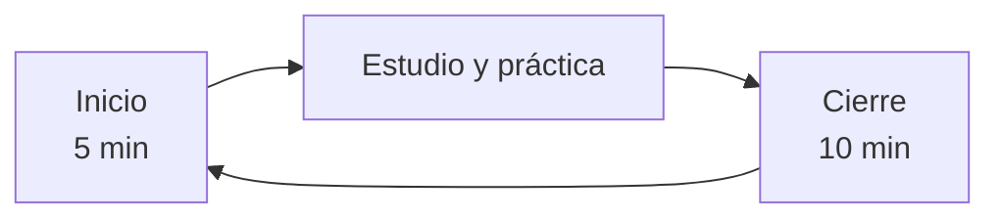

# Cómo estudiar

Esta guía es **opcional**. Con *Mi progreso* alcanza para seguir el curso. Si preferís llevar tu propio registro, con apuntes, horas y repasos, o vas a estudiar con un tutor de IA, acá tenés un método probado.

## El cuaderno de estudio

Es una carpeta privada, en tu computadora, con unos pocos archivos de texto:

| Archivo | Para qué sirve |
|---|---|
| `PROGRESO.md` | Estado de tus lecciones y módulos, y una bitácora de sesiones |
| `REFUERZO.md` | Temas que te costaron y cuándo repasarlos |
| `PUNTO-DE-PARTIDA.md` | Tu situación inicial: experiencia, objetivos, tiempo y presupuesto |

### Crearlo

1. Descargá el curso: en el [repositorio](https://github.com/CaminosMarina/curso-ia), **Code → Download ZIP**. También podés clonarlo con `git clone https://github.com/CaminosMarina/curso-ia.git`.
2. Copiá la carpeta `plantillas/cuaderno-estudiante/` a otro lugar y renombrala `mi-cuaderno`. Tiene que quedar **fuera** de la carpeta del curso.

    === "PowerShell (Windows)"

        ```powershell
        Copy-Item -Recurse curso-ia\plantillas\cuaderno-estudiante mi-cuaderno
        ```

    === "Bash (Linux, macOS, Git Bash)"

        ```bash
        cp -r curso-ia/plantillas/cuaderno-estudiante mi-cuaderno
        ```

3. Completá `PUNTO-DE-PARTIDA.md` y el encabezado de `PROGRESO.md`, sin datos sensibles.

> [!WARNING]
> No guardes el cuaderno en un *fork* del curso en GitHub: un fork de un repositorio público también es público. Si querés respaldo en GitHub, usá un repositorio **privado** propio.

## Una sesión de estudio



**Inicio.** Mirá en tu cuaderno qué quedó pendiente y si tenés algún repaso. Si vas a empezar una lección nueva, revisá sus prerrequisitos en la portada del módulo.

**Estudio y práctica.** Seguí la lección. Anotá dudas en el momento y guardá lo que produzcas (respuestas, capturas, código).

**Cierre.** Actualizá el estado de la lección, anotá las horas reales y escribí qué sigue la próxima vez. Si algo te costó, anotalo en `REFUERZO.md`.

## Repasar lo que costó

Cuando una autoevaluación no sale bien, anotá el tema en `REFUERZO.md`, repasalo con otra fuente o con ejercicios distintos y volvé a evaluarte. Después programá repasos cortos, cada vez más espaciados: por ejemplo en la sesión siguiente, 3 sesiones después y 6 sesiones después. Repasar así consolida lo aprendido mucho mejor que releer todo de una vez.

## Evidencia

Una lección está *Completada* cuando superaste su autoevaluación o hiciste su práctica, según el tipo de lección (ver [Cómo se aprueba](../sobre/evaluacion.md)). Leerla no alcanza: entender al leer da una sensación de dominio que muchas veces no resiste el primer ejercicio. Guardar tus respuestas y prácticas en el cuaderno te permite comprobarlo.
