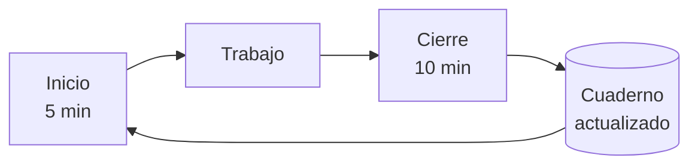

# L0.1.1 · Mapa del curso y protocolo de sesión

> [!NOTE]
> **Antes de empezar**
>
> - **Vas a aprender a:** ubicar cualquier lección por su ID; decidir si podés empezar un módulo según sus prerrequisitos; explicar por qué se usa una herramienta antes de construirla; asignar el estado correcto a una lección según la evidencia; y aplicar el protocolo de sesión para registrar tu avance.
> - **Necesitás:** nada previo. Es la primera lección. Un editor de texto para el ejercicio (Git se instala en L0.2.1).
> - **Tiempo:** 1 h 30 min (45 min de lectura y 45 de práctica) · **Costo:** gratis.

> [!WARNING]
> 📝 **Borrador.** Esta lección todavía no pasó la revisión final.

## Teoría

### 1. Cómo está organizado el curso

El curso tiene cuatro niveles de organización:

| Nivel | Qué es | Ejemplo |
|---|---|---|
| **Bloque** | Grupo de módulos con un propósito común | Bloque I · Fundamentos y uso profesional |
| **Módulo** | Tema grande, con objetivo, horas, evaluación y, en general, un proyecto | M4 · Agentes de programación: uso guiado |
| **Unidad** | Subtema dentro de un módulo | U4.2 · Flujo de trabajo profesional |
| **Lección** | Unidad mínima de estudio, de 1 a 3 horas | L4.2.3 · Instrucciones persistentes |

Además hay **electivas** (E1 a E3), que son especializaciones opcionales, y **proyectos** (P1 a P10), que integran varios módulos.

**El ID de una lección** tiene la forma `Lm.u.n`: módulo `m`, unidad `u`, lección `n`. L4.2.3 es la lección 3 de la unidad 2 del módulo 4. Un ID **nunca se reutiliza**, aunque el programa cambie.

**El tipo de lección** indica cómo se verifica lo aprendido:

- `C` **conceptual:** con preguntas.
- `P` **práctica:** con un ejercicio que funciona y que sabés justificar.
- `M` **mixta:** de las dos formas.

Los cinco bloques:

| Bloque | Módulos | Idea central |
|---|---|---|
| I · Fundamentos y uso profesional | M0 a M5 | Cómo funciona un modelo de lenguaje, cómo darle instrucciones y cómo usar asistentes, agentes de programación y automatizaciones simples |
| II · Construir con modelos | M6 a M8 | API, gestión del contexto y RAG |
| III · Agentes e interoperabilidad | M9 a M12 | Agentes desde cero, MCP, agentes de programación por dentro, skills y plugins |
| IV · Automatización y sistemas avanzados | M13 a M15 | n8n con agentes, frameworks y sistemas multiagente |
| V · Producción e integración | M16 y M17 | Seguridad, evaluación, operación y proyecto final |

**Dónde buscar cada cosa:** la portada de cada módulo tiene su objetivo, prerrequisitos y lecciones. El [índice de lecciones](../programa/indice.md) tiene las 233 juntas. [El programa](../programa/index.md) tiene el mapa de dependencias y las horas.

### 2. Prerrequisitos y rutas

- **Prerrequisito duro:** conocimiento indispensable. Sin él, el módulo no se puede seguir.
- **Prerrequisito recomendado:** mejora la experiencia, pero no impide empezar. Se puede retomar después.

En el [mapa de aprendizaje](../programa/index.md#mapa-de-aprendizaje), una flecha continua es un prerrequisito duro y una punteada, uno recomendado. Cada módulo también los enumera en su portada.

**Para decidir si podés empezar un módulo:** si todos sus prerrequisitos duros están aprobados, podés. Si falta solo un recomendado, también podés: anotá que conviene retomarlo. Si falta un duro, todavía no.

El programa permite rutas en paralelo:

- **M5** (n8n) solo exige M0: se puede hacer en cualquier momento del Bloque I.
- **M3 y M4** se pueden cursar juntos después de M2.
- **M15 y M16** se pueden cursar en cualquier orden después de M14.

### 3. Nivel 1 y Nivel 2: usar antes de construir

Cada herramienta importante se estudia dos veces:

| Herramienta | Nivel 1: usar y configurar | Nivel 2: construir y profundizar |
|---|---|---|
| Asistentes, proyectos y memoria | M3 | M7 |
| Connectors y servidores MCP | M3 | M10 |
| Agentes de programación | M4 | M11 |
| Skills y plugins | M3 y M4 | M11 y M12 |
| Automatización con n8n | M5 | M13 |

**Por qué en ese orden:**

- **Utilidad temprana:** al terminar el Bloque I ya usás la IA en tu trabajo.
- **Preguntas concretas:** usar una herramienta genera preguntas ("¿por qué olvidó esto?", "¿por qué me pidió permiso?") que el Nivel 2 responde abriendo la caja.
- **Criterio:** después de construir tu propio equivalente, sabés cuándo conviene la herramienta existente y cuándo una solución propia.

### 4. Estados de aprendizaje y evidencia

Cada lección tiene un estado en tu **cuaderno**: tus registros privados, en una carpeta separada del curso.

| Estado | Significado | Cuándo se alcanza |
|---|---|---|
| ⬜ Pendiente | No empezada | — |
| 📖 Estudiada | Recorriste la lección completa | La leíste de punta a punta. No implica comprensión |
| 🛠️ Practicada | Hiciste la actividad mínima | Hay evidencia de la práctica |
| ✅ Aprobada | La comprensión está verificada | Superaste la verificación según el tipo de lección |
| 🔁 Necesita refuerzo | No superaste la verificación de una lección **todavía no aprobada** | Registraste una dificultad |

**Evidencia** es lo que demuestra un estado: una respuesta escrita, un archivo, un *commit*, una captura o la salida de un comando. **Sin evidencia, el estado no cambia.**

¿Por qué tanto cuidado? Leer una explicación clara da la sensación de haberla entendido, pero eso no garantiza poder aplicarla. A esa trampa se la suele llamar **ilusión de fluidez**. Separar "lo estudié" (📖), "lo practiqué" (🛠️) y "lo demostré" (✅) te protege de ella.

**Verificación según el tipo:**

| Tipo | Actividad mínima (🛠️) | Verificación (✅) |
|---|---|---|
| `C` | Una pregunta de aplicación respondida por escrito | 3 a 5 preguntas con 80% o más de respuestas correctas, incluida una de diagnóstico ("¿por qué pasa X?") |
| `P` | El ejercicio hecho, con evidencia | El ejercicio funcionando y justificado: qué hiciste, por qué, alternativas y riesgos |
| `M` | Ejercicio o pregunta de aplicación | Las dos verificaciones anteriores |

**Tres reglas:**

1. Una lección **nunca** pasa a ✅ solo porque la leíste.
2. Si más adelante descubrís un error sobre una lección ya aprobada, la lección **conserva** su ✅. Solo se registra la dificultad.
3. Un **módulo** está aprobado cuando todas sus lecciones están en ✅, la evaluación del módulo alcanza el 80% o más, el proyecto (si tiene) también, y no queda ninguna dificultad bloqueante abierta.

### 5. Dificultades

Una **dificultad** es una brecha de comprensión. Se registra en tu `REFUERZO.md` con un ID (`D-001`, `D-002`…) y una severidad:

- 🔴 **Bloqueante:** afecta un prerrequisito duro de lo que sigue. Bloquea solo lo que depende de ese conocimiento.
- 🟡 **Importante:** no impide avanzar; se trabaja en paralelo.
- 🟢 **Menor:** un detalle para pulir.

Para superarla hace falta una verificación **distinta** de la que la reveló. Después se hacen **repasos espaciados**: repasos cortos a intervalos crecientes.

### 6. Protocolo de sesión

Con pocas horas por semana, las sesiones quedan separadas por días. El protocolo de sesión es una rutina fija para que cada sesión retome donde quedó la anterior sin depender de tu memoria.



**Inicio** (5 minutos):

1. Abrí tu `PROGRESO.md` y mirá "Sesión en curso". Si figura una sesión abierta, cerrala primero con lo que recuerdes.
2. Si tu `REFUERZO.md` tiene repasos pendientes, hacelos primero (5 minutos como máximo).
3. Leé la "Próxima actividad". Si vas a empezar una lección nueva, confirmá sus prerrequisitos.
4. Anotá "Sesión en curso: Abierta · fecha · lección".

**Trabajo:** estudiá y practicá. Anotá las dudas en el momento y guardá la evidencia a medida que la producís.

**Cierre** (10 minutos):

1. Actualizá el estado de la lección, **solo con evidencia**.
2. Registrá las dificultades nuevas en `REFUERZO.md`.
3. Agregá una fila a la bitácora: fecha, qué hiciste, **horas reales**, cambios de estado y próxima actividad.
4. Dejá "Sesión en curso: Ninguna".
5. Si usás Git (desde L0.2.1), hacé un *commit*.

**Tu cuaderno es la única fuente de verdad sobre tu progreso.** Si estudiás con un asistente de IA, tené en cuenta que no recuerda las conversaciones anteriores de forma confiable (lo vas a entender a fondo en M1 y M3). Por eso el asistente puede proponer cambios, pero el registro es tu cuaderno, y comprobás cada cambio abriendo el archivo. Cómo trabajar con un tutor de IA está en [Estudiar con un tutor de IA](../empezar/tutor.md).

> [!NOTE]
> **Específico de herramienta** · verificado el 2026-10-12 · fuentes: [Claude Help Center: proyectos](https://support.claude.com/en/articles/9519177) · [OpenAI Help Center: proyectos en ChatGPT](https://help.openai.com/en/articles/10169521-projects-in-chatgpt)
>
> Claude y ChatGPT permiten crear **proyectos** con instrucciones y archivos, también en sus planes gratuitos (con límites: en Claude, hasta cinco proyectos; en ChatGPT Free, hasta 5 archivos por proyecto). Un tutor configurado así lee **copias** de tus archivos, pero no puede modificar tu cuaderno: te da un bloque de texto para que lo pegues vos.

> [!TIP]
> **Errores frecuentes**
>
> - Marcar ✅ al terminar de leer. Leer da 📖.
> - Tratar un prerrequisito recomendado como duro (y frenar sin necesidad), o al revés.
> - Saltear el cierre de sesión: la sesión siguiente empieza sin saber dónde quedaste.
> - Guardar el cuaderno dentro de la carpeta del curso o en un fork público: se mezclan o se publican tus datos.
> - Tomar la palabra de un asistente ("listo, lo guardé") como registro.
> - Anotar horas estimadas en lugar de reales.

## Práctica

### Práctica guiada

Abrí el [índice de lecciones](../programa/indice.md) y [El programa](../programa/index.md) en otra pestaña.

1. **Ubicá L3.5.2.** Anotá su módulo, su unidad (con el nombre), su tipo, su nivel y su bloque.

    **Resultado esperado:** cinco datos, sacados del índice y de la tabla de bloques de esta lección.
2. **Leé dependencias.** En la portada de M10 y en la de M13, anotá los prerrequisitos duros y los recomendados.

    **Resultado esperado:** dos listas por módulo.
3. **Estimá el tiempo del Bloque I.** Sumá las horas de M0 a M5 (tabla [Módulos y horas](../programa/index.md#módulos-y-horas)) y dividí por las horas que le vas a dedicar por semana. Sumá un 10% de margen para repasos.

    **Resultado esperado:** un total de horas y una cantidad de semanas.
4. **Clasificá situaciones.** ¿Qué estado corresponde en cada caso?
    - a) Hiciste el ejercicio de una lección `P`, funciona, pero todavía no sabés explicar por qué elegiste esa configuración.
    - b) En una lección `M` respondiste bien las preguntas, y el ejercicio funciona y está justificado.
    - c) En una lección `C` respondiste bien 3 de 5 preguntas.

Comprobá tus resultados en las [soluciones de la práctica guiada](soluciones/l0-1-1.md#práctica-guiada).

### Ejercicio: armar tu cuaderno y probar el protocolo

**Objetivo:** crear tu registro privado, separado del curso, y registrar una sesión completa con estados respaldados por evidencia.

1. **Creá tu cuaderno fuera del curso,** con la plantilla del cuaderno, siguiendo los pasos 1 a 4 de [Cómo empezar](../empezar/index.md). Al final tenés una carpeta `mi-cuaderno/` con `PROGRESO.md`, `REFUERZO.md` y `PUNTO-DE-PARTIDA.md`.
2. **Completá `PUNTO-DE-PARTIDA.md`,** sin datos sensibles.
3. **Completá el encabezado de `PROGRESO.md`:** versión académica del programa (1.2), modalidad, dedicación semanal y fecha de inicio.
4. **Abrí la sesión:** en "Sesión en curso", escribí `Abierta · <fecha> · L0.1.1`.
5. **Escribí tu ruta para el Bloque I** en un archivo nuevo, `mi-cuaderno/evidencias/L0.1.1-ruta.md`: en qué orden vas a hacer M0 a M5, qué vas a hacer en paralelo, cuántas semanas estimás (con el cálculo) y por qué, según los prerrequisitos. Esta es la **pregunta de aplicación** de la lección.
6. **Registrá la lección:** en `PROGRESO.md`, sección Lecciones, agregá la fila de L0.1.1 con el estado que corresponde **a lo que hiciste hasta ahora** y el enlace a la evidencia.
7. **Cerrá la sesión:** agregá una fila a la bitácora, dejá "Sesión en curso: Ninguna" y completá "Próxima actividad".

**Criterios de aceptación:**

- [ ] `mi-cuaderno/` está **fuera** de la carpeta del curso.
- [ ] `mi-cuaderno/` contiene `PROGRESO.md`, `REFUERZO.md`, `PUNTO-DE-PARTIDA.md` y `evidencias/L0.1.1-ruta.md`.
- [ ] El encabezado de `PROGRESO.md` indica la versión académica, la modalidad y la dedicación semanal.
- [ ] La ruta respeta los prerrequisitos duros, y el cálculo de semanas usa las horas del programa.
- [ ] La fila de L0.1.1 tiene un estado coherente con la evidencia: 🛠️ si hiciste solo la pregunta de aplicación, o ✅ si además corregiste la autoevaluación con 4 o más de 5. **Nunca ✅ sin autoevaluación.**
- [ ] La bitácora tiene una fila de esta sesión, con horas reales y próxima actividad, y "Sesión en curso" dice `Ninguna`.
- [ ] Ningún archivo contiene credenciales ni datos sensibles.

**Cómo verificar** (desde la carpeta que contiene `mi-cuaderno/` y la copia del curso):

=== "PowerShell (Windows)"

    ```powershell
    Get-ChildItem mi-cuaderno, mi-cuaderno\evidencias
    Select-String -Path mi-cuaderno\PROGRESO.md -Pattern "Versión académica", "^\| L0.1.1", "Sesión en curso"
    ```

=== "Bash (Linux, macOS, Git Bash)"

    ```bash
    ls mi-cuaderno mi-cuaderno/evidencias
    grep -n -e "Versión académica" -e "^| L0.1.1" -e "Sesión en curso" mi-cuaderno/PROGRESO.md
    ```

**Resultado esperado:** se listan los archivos del cuaderno y aparecen la línea de la versión académica, la fila de L0.1.1 y "Sesión en curso" con `Ninguna`. Sin terminal, abrí cada archivo y recorré los criterios uno por uno.

<details markdown>
<summary>Pista 1 · ¿Qué estado pongo si todavía no hice la autoevaluación?</summary>

La pregunta de aplicación es la actividad mínima de una lección `C`. Mirá la tabla "Registrá tu avance" al final de la autoevaluación.

</details>

<details markdown>
<summary>Pista 2 · ¿Puedo poner M5 antes que M1?</summary>

Mirá cuáles son los prerrequisitos duros de M5 en su portada.

</details>

La guía de corrección y un ejemplo resuelto están en las [soluciones del ejercicio](soluciones/l0-1-1.md#ejercicio). Consultalas después de intentar.

## Autoevaluación

Respondé por escrito en tu cuaderno, **sin mirar las soluciones**. Podés consultar el programa.

1. **Ubicar.** ¿Qué indica el ID L11.3.5? ¿A qué nivel y bloque pertenece, y qué hace falta para aprobarla?
2. **Prerrequisitos.** Aprobaste M0, M1 y M2. ¿Cuáles de estos módulos podés empezar: M3, M4, M5, M6? Justificá cada caso.
3. **Estados.**
    - a) En L1.2.1 (tipo `M`) hiciste el ejercicio y guardaste la evidencia, pero todavía no respondiste las preguntas. ¿Qué estado corresponde?
    - b) Semanas después de aprobar L1.4.2, descubrís que confundís el límite de salida con el tamaño total de la ventana de contexto. ¿Qué pasa con el estado de L1.4.2 y qué registrás?
4. **Diagnóstico.** Otra persona propone saltear M3 e ir directo a M10 para "aprender MCP de verdad". ¿Lo permite el programa? ¿Qué argumentos da el curso para hacer primero el Nivel 1?
5. **Diagnóstico.** Estudiás con un asistente de IA en un chat sin acceso a tus archivos. Al cerrar, te dice: "Listo, actualicé tu `PROGRESO.md`". ¿Qué está mal y qué hacés?

**Aprobación:** 4 o más respuestas correctas de 5 (80%). Corregí con las [respuestas y la guía de corrección](soluciones/l0-1-1.md#autoevaluación).

### Registrá tu avance

| Situación | Estado de L0.1.1 | Evidencia |
|---|---|---|
| Leíste la lección | 📖 | — |
| Escribiste tu ruta del Bloque I | 🛠️ | `evidencias/L0.1.1-ruta.md` |
| Obtuviste 4 de 5 o más en la autoevaluación | ✅ | Tus respuestas y la corrección |
| Obtuviste menos de 4 | 🔁 | La dificultad, registrada en `REFUERZO.md` |

## Resumen

- El curso se organiza en bloques, módulos, unidades y lecciones. Cada lección tiene un ID estable (`Lm.u.n`) y un tipo (`C`, `P` o `M`) que define cómo se verifica.
- Los prerrequisitos duros son indispensables; los recomendados no impiden avanzar. Hay rutas en paralelo.
- El Nivel 1 (usar) va antes que el Nivel 2 (construir): utilidad temprana, preguntas concretas y criterio.
- Los estados ⬜ 📖 🛠️ ✅ 🔁 separan "lo estudié", "lo practiqué" y "lo demostré". Cada cambio necesita evidencia.
- Una dificultad posterior no borra una aprobación: se registra y se trabaja con repasos espaciados.
- Cada sesión tiene inicio, trabajo y cierre. Tu cuaderno es la única fuente de verdad sobre tu progreso.

## Para profundizar

- [El programa](../programa/index.md): principios, mapa de dependencias y horas.
- [Evaluación y estados](../programa/evaluacion.md): todas las reglas de aprobación.
- [Cómo empezar](../empezar/index.md) y [Estudiar con un tutor de IA](../empezar/tutor.md).
- **Términos nuevos en el [glosario](../glosario.md):** programa académico, ID de lección, prerrequisito duro y recomendado, Nivel 1 y Nivel 2, estado de aprendizaje, evidencia, cuaderno, protocolo de sesión, dificultad y repaso espaciado.
