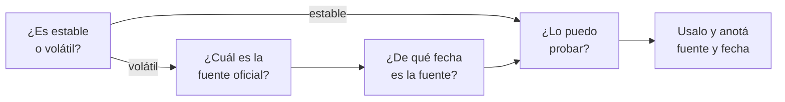

# Aprender en un campo que cambia cada mes

> [!NOTE]
> **Antes de empezar**
>
> - **Vas a aprender a:** distinguir lo que dura de lo que cambia en IA, elegir fuentes confiables, leer un *changelog* y verificar lo que afirma un modelo de IA, incluido un tutor.
> - **Necesitás:** [L0.1.1](l0-1-1-mapa-del-curso.md). Para la práctica, una cuenta gratuita de cualquier asistente de IA (Claude, ChatGPT, Gemini u otro).
> - **Tiempo:** 1 hora (25 min de lectura y 35 de práctica) · **Costo:** gratis.

> [!WARNING]
> 📝 **Borrador.** Esta lección todavía no pasó la revisión final.

## Teoría

### 1. Lo que dura y lo que cambia

En IA salen modelos, funciones y precios nuevos casi todas las semanas. Si intentás seguir todo, te agotás; si no seguís nada, trabajás con información vieja. La salida es separar dos tipos de conocimiento:

| | Conocimiento **estable** | Conocimiento **volátil** |
|---|---|---|
| **Qué es** | Cómo funcionan las cosas | Los detalles de una herramienta en un momento dado |
| **Ejemplos** | Qué es un token; por qué un modelo puede inventar datos; cómo funciona un agente; por qué una clave de API no va en Git | Nombres y versiones de modelos; precios; límites de cada plan; pantallas y menús; parámetros de una API |
| **Cuánto dura** | Años | Semanas o meses |
| **Cómo se aprende** | En profundidad, con práctica | Se consulta cuando hace falta, con fecha y fuente |

Algunos ejemplos usan términos que todavía no viste (*token*, *agente*); se explican más adelante.

Este curso pone el esfuerzo en lo estable. Lo volátil aparece en recuadros *Específico de herramienta*, con la fecha en que se verificó y la fuente oficial, para que puedas comprobar si sigue vigente.

Los conceptos también evolucionan, pero despacio: que un asistente de IA pueda usar herramientas externas (buscar en la web, leer un archivo) existe hace años; qué herramientas ofrece cada producto cambia cada pocos meses. Si entendés el concepto, cada novedad es una variante de algo que ya conocés.

### 2. Qué fuentes usar

No todas las fuentes valen lo mismo. Ordenadas de más a menos confiables para saber **cómo es algo hoy**:

1. **Documentación oficial** del proveedor: guías y referencia de la API. Es la que define cómo funciona la herramienta.
2. **Notas de versión** (*changelog* o *release notes*): la lista fechada de cambios. Dice qué cambió y desde cuándo.
3. **Especificaciones y repositorios oficiales**: por ejemplo, la especificación de un protocolo o el repositorio de una herramienta de código abierto.
4. **Blogs de ingeniería y anuncios del proveedor**: explican el porqué de un cambio, pero a veces mezclan información técnica con promoción.
5. **Fuentes secundarias**: tutoriales, videos, foros, redes sociales y respuestas de modelos de IA. Sirven para **descubrir** algo y entenderlo, no para **confirmar** cómo es hoy.

Una fuente secundaria no es mala: muchas explican mejor que la documentación. El problema es que envejecen sin avisar. Un tutorial de hace seis meses puede mostrar un menú que ya no existe.

> [!TIP]
> **Regla práctica:** aprendé con la fuente que mejor explique; confirmá con la documentación oficial o el *changelog* antes de usar un dato volátil en algo que importa.

### 3. Cómo leer un *changelog*

Un *changelog* es un registro de cambios ordenado por fecha, de lo más nuevo a lo más viejo. Al leerlo, buscá:

- **La fecha:** ¿el cambio es posterior a la información que tenías?
- **Cambios incompatibles** (*breaking changes*): cosas que dejan de funcionar como antes y obligan a modificar tu código o tu configuración.
- **Deprecaciones** (*deprecations*): funciones o modelos que siguen andando, pero se van a retirar en una fecha anunciada. Te dan tiempo para migrar.
- **Etapa de cada función:** *beta*, *preview* o experimental significa que todavía puede cambiar o desaparecer; disponible en general (*GA*, *generally available*) significa estable.
- **Alcance:** a qué planes, regiones o plataformas aplica.

Muchos proveedores tienen además una página de **deprecaciones de modelos**, con las fechas en que cada modelo deja de estar disponible. Si construís algo que usa un modelo por API, esa página te importa.

### 4. Por qué un modelo de IA se equivoca sobre el presente

Un **modelo de lenguaje** es el tipo de IA que está detrás de asistentes como ChatGPT, Claude o Gemini (cómo funciona se estudia en el Módulo 1). Aprende de un conjunto enorme de textos reunidos hasta una fecha: su **fecha de corte de conocimiento**. Todo lo que pasó después, no lo sabe, salvo que la aplicación le dé información nueva, por ejemplo con una búsqueda web.

Por ejemplo, si la fecha de corte de un modelo es enero y en marzo una herramienta cambia sus precios, el modelo va a seguir respondiendo con los precios de enero.

Además, un modelo no consulta una base de datos: **genera** la respuesta más probable según lo que aprendió. Por eso puede producir un dato falso con total seguridad. A esto se le llama **alucinación**. Dos consecuencias:

- **El tono seguro no es evidencia.** Un modelo usa el mismo tono para un dato correcto que para uno inventado.
- **Los datos volátiles son los más riesgosos:** cambian después de la fecha de corte y, además, son números y nombres precisos, fáciles de inventar de forma creíble.

Con búsqueda web, un modelo mejora mucho en temas actuales, pero puede leer mal una página, citar una fuente vieja o mezclar dos productos. Siempre conviene abrir la fuente que cita, también cuando el que responde es tu tutor de IA.

### 5. Cómo verificar una afirmación

Antes de usar un dato que te dio un modelo, un video o un colega, hacete cuatro preguntas:



1. **¿Es estable o volátil?** Si es volátil, no lo des por cierto sin fuente.
2. **¿Cuál es la fuente oficial?** Buscala vos, o pedile al modelo el enlace y abrilo.
3. **¿De qué fecha es?** Una fuente oficial vieja también puede estar desactualizada: mirá la fecha de la página o del *changelog*.
4. **¿Lo puedo probar?** Como persona que programa, tenés la mejor verificación: ejecutar. Si el modelo dice que un parámetro existe, una llamada de prueba lo confirma en segundos.

Señales de que conviene verificar con más cuidado:

- Números precisos: precios, límites, tamaños, fechas.
- Nombres de versiones, modelos, funciones o parámetros.
- Enlaces: un modelo puede inventar una dirección con un formato perfectamente creíble.
- Afirmaciones como "ya no existe" o "es la última versión".
- "Según la documentación…" sin enlace.

También podés pedirle al modelo que te ayude a verificar: "decime de dónde sale ese dato y con qué fecha", o "si no estás seguro, decilo". No reemplaza abrir la fuente, pero reduce los errores.

### 6. Mantenerse al día sin ahogarse

- **Pocas fuentes, buenas:** las notas de versión de las dos o tres herramientas que más usás.
- **Revisión periódica y corta:** por ejemplo, 15 minutos por semana para leer las novedades.
- **Justo a tiempo:** el resto, consultalo cuando lo necesites, no por las dudas.
- **Seguir repositorios:** en GitHub podés suscribirte solo a las versiones (*releases*) de un repositorio: botón *Watch* › *Custom* › *Releases*.
- **Desconfiar del entusiasmo:** "esto cambia todo" rara vez cambia todo. Preguntate qué concepto hay detrás y si resuelve un problema que tenés.

> [!NOTE]
> **Específico de herramienta** · verificado el 2026-10-15 · fuentes: las páginas oficiales de la tabla, por ejemplo [Claude Platform release notes](https://platform.claude.com/docs/en/release-notes/overview). Las direcciones pueden cambiar.
>
> | Herramienta | Notas de versión | Otras páginas útiles |
> |---|---|---|
> | Claude (aplicaciones) | [Claude Help Center: Release notes](https://support.claude.com/en/articles/12138966-release-notes) | |
> | Claude (API) | [Claude Platform release notes](https://platform.claude.com/docs/en/release-notes/overview) | [Deprecaciones de modelos](https://platform.claude.com/docs/en/about-claude/model-deprecations) |
> | Claude Code | [CHANGELOG en GitHub](https://github.com/anthropics/claude-code/blob/main/CHANGELOG.md) | |
> | ChatGPT | [ChatGPT Release Notes](https://help.openai.com/en/articles/6825453-chatgpt-release-notes) | |
> | OpenAI (API) | [Changelog de la API](https://developers.openai.com/api/docs/changelog) | [Deprecaciones](https://developers.openai.com/api/docs/deprecations) |
> | Gemini (API) | [Gemini API release notes](https://ai.google.dev/gemini-api/docs/changelog) | |
> | n8n | [n8n release notes](https://docs.n8n.io/release-notes/) | |

> [!TIP]
> **Errores frecuentes**
>
> - Creer un dato porque lo dijo un modelo con seguridad, o porque aparece en un video con muchas visitas.
> - Abrir la documentación oficial, pero no mirar la fecha.
> - Confiar en un enlace que dio un modelo sin abrirlo.
> - Intentar estar al día con todo y abandonar a las pocas semanas.

## Práctica

Esta lección es conceptual: la práctica aplica la teoría a casos reales. Guardá tus respuestas donde quieras (un archivo, tu cuaderno o un papel).

1. **Clasificá afirmaciones.** Para cada una, decidí si es **estable** o **volátil**, y en una línea por qué:

    1. Un modelo de lenguaje genera texto prediciendo la continuación más probable.
    2. El plan gratuito de un asistente permite cinco proyectos.
    3. Una clave de API no se sube a un repositorio.
    4. El modelo más avanzado de un proveedor se llama de tal forma.
    5. La ventana de contexto incluye las instrucciones, el historial y la respuesta.
    6. Para conectar un servidor MCP a una aplicación, se edita tal archivo de configuración.
    7. Usar un modelo por API cuesta tantos dólares por millón de tokens.
    8. Un agente decide qué herramienta usar en cada paso.

    **Resultado esperado:** ocho clasificaciones con su motivo. Algunas palabras todavía no las conocés (*token*, *MCP*): no hace falta para clasificarlas.

2. **Armá tu lista de fuentes.** Elegí tres herramientas que vayas a usar en el curso (por ejemplo, un asistente como Claude o ChatGPT, la API de un proveedor y n8n, una herramienta de automatización que se usa en el Módulo 5). Para cada una, buscá su documentación oficial y sus notas de versión, y anotá la fecha de la entrada más reciente.

    **Resultado esperado:** una tabla de tres filas con herramienta, enlace a la documentación, enlace a las notas de versión y fecha de la última novedad.

3. **Poné a prueba a un asistente.** En el asistente de IA que prefieras, en una conversación nueva, preguntá:

    ```text
    ¿Cuál es tu fecha de corte de conocimiento? ¿Tenés búsqueda web en esta conversación?
    ```

    Tené en cuenta que esta respuesta también puede ser imprecisa: algunos proveedores publican la fecha de corte en la página de cada modelo, y podés compararla.

    Después hacé una pregunta volátil sobre una de tus tres herramientas, por ejemplo:

    ```text
    ¿Cuál es la versión más reciente de n8n y qué novedades trajo? Indicá la fuente y su fecha.
    ```

    Compará la respuesta con las notas de versión del paso 2 y clasificala: **correcta**, **desactualizada**, **inventada** o **sin respuesta** (dijo que no sabía).

    **Resultado esperado:** la clasificación y, si no fue correcta, qué señal del apartado 5 te podría haber alertado.

4. **Elegí tu rutina.** Decidí cuándo vas a revisar novedades (día y duración) y de qué fuentes. Si usás GitHub, suscribite a las *releases* de un repositorio que te interese.

    **Resultado esperado:** una línea, por ejemplo: "Viernes, 15 minutos: notas de versión de Claude y de n8n".

Comprobá el paso 1 en las [soluciones de la práctica](soluciones/l0-1-2.md#práctica). Los pasos 2 a 4 no tienen una única respuesta correcta.

## Autoevaluación

Elegí una respuesta en cada pregunta. La página te corrige al instante y explica por qué. Para completar la lección necesitás 4 de 5 correctas.

```quiz
Un asistente de IA te dice, con total seguridad, cuántos archivos admite el plan gratuito de una herramienta. La ayuda oficial dice otro número. ¿Cuál es la explicación más probable?
- [ ] El asistente tiene información más nueva que la ayuda oficial
- [x] El dato es posterior a su fecha de corte, o el modelo generó un número creíble sin tenerlo
- [ ] La ayuda oficial tiene un error, porque el asistente no se equivoca en datos concretos
> Los límites de los planes cambian seguido y suelen ser posteriores a la fecha de corte del modelo. Además, un modelo genera la respuesta más probable, aunque no tenga el dato. Su seguridad no es evidencia: gana la fuente oficial, mirando su fecha.
```

```quiz
Un video tutorial de hace ocho meses y las notas de versión oficiales de la semana pasada se contradicen sobre cómo configurar una función. ¿Qué hacés?
- [ ] Sigo el video, porque explica mejor y paso a paso
- [ ] Busco un tercer video para desempatar
- [x] Sigo las notas de versión: son oficiales y más recientes; el video puede servirme para entender el concepto
> La fuente oficial y fechada decide cómo es algo hoy. Una fuente secundaria puede explicar mejor, pero envejece sin avisar.
```

```quiz
¿Cuál de estas afirmaciones conviene verificar antes de usarla en un proyecto?
- [ ] Un modelo de lenguaje puede inventar datos con tono seguro
- [x] Un modelo determinado cuesta cierta cantidad de dólares por millón de tokens
- [ ] Las claves de API no se guardan en un repositorio
> Los precios son conocimiento volátil: cambian seguido y son números precisos, fáciles de inventar. Las otras dos son conocimiento estable.
```

```quiz
Un modelo te da un enlace a la documentación oficial que confirma lo que dice. ¿Qué hacés con ese enlace?
- [ ] Nada: si lo citó, el dato está confirmado
- [x] Lo abro y compruebo que exista, que diga eso y de qué fecha es
- [ ] Le pregunto al mismo modelo si el enlace es correcto
> Un modelo puede inventar una dirección con formato creíble, o citar una página que dice otra cosa. Preguntarle al mismo modelo no agrega evidencia: hay que abrir la fuente.
```

```quiz
¿Cuál es la estrategia más sostenible para mantenerte al día en IA?
- [ ] Seguir todas las novedades de todos los proveedores todos los días
- [x] Pocas fuentes oficiales con una revisión corta y periódica, y el resto consultarlo cuando lo necesites
- [ ] Estudiar solo conceptos y no revisar nunca las herramientas
> Seguir todo no es sostenible, y no revisar nada te deja con información vieja. Lo estable se estudia a fondo; lo volátil se revisa con pocas fuentes y se consulta justo a tiempo.
```

## Resumen

- En IA hay conocimiento **estable** (cómo funcionan las cosas), que se estudia a fondo, y **volátil** (versiones, precios, planes, pantallas), que se consulta con fecha y fuente.
- Para saber cómo es algo hoy, la referencia es la **documentación oficial** y las **notas de versión**; las fuentes secundarias sirven para descubrir y entender.
- En un *changelog* importan la fecha, los cambios incompatibles, las deprecaciones y si una función es *beta* o estable.
- Un modelo tiene una **fecha de corte de conocimiento** y puede **alucinar**: su seguridad no es evidencia, y menos en datos volátiles.
- Para verificar: ¿estable o volátil?, ¿fuente oficial?, ¿de qué fecha?, ¿lo puedo probar?
- Mantenerse al día: pocas fuentes, revisión corta y periódica, y el resto justo a tiempo.

## Para profundizar

- [Estudiar con un tutor de IA](../empezar/tutor.md): cómo configurar un tutor y las señales de que no está funcionando bien.
- **Módulo 1:** cómo genera texto un modelo y por qué alucina (L1.5.1).
- **Términos nuevos en el [glosario](../glosario.md):** fecha de corte de conocimiento, alucinación, *changelog*, deprecación, conocimiento estable y volátil.
