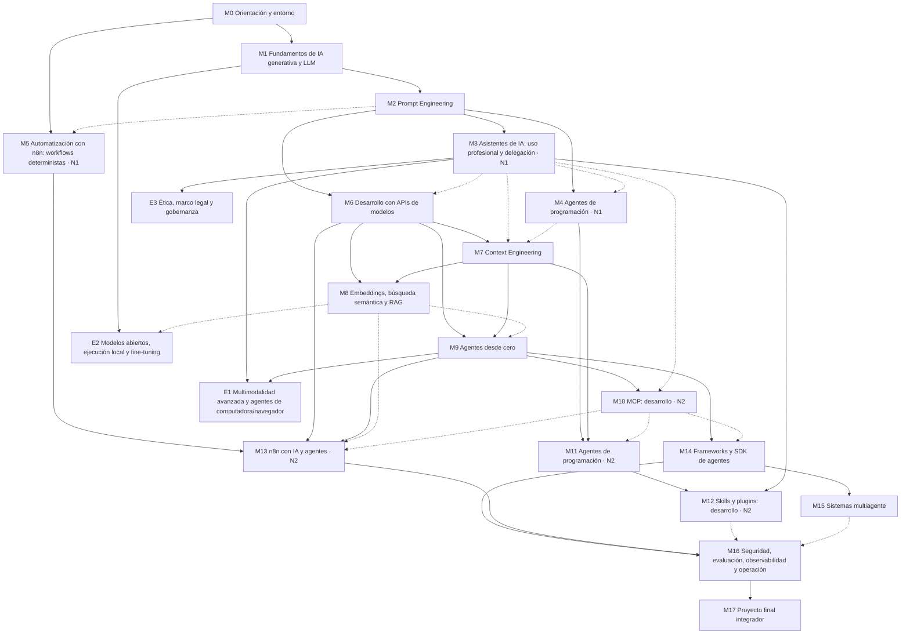

# El programa

> [!NOTE]
> **Versión académica 1.2** (12/10/2026) · 18 módulos · 233 lecciones · 10 proyectos · núcleo de 486 h (526 h con electivas).
> El programa completo es visible, pero no todas las lecciones tienen material todavía: en el [índice de lecciones](indice.md) y en la portada de cada módulo, las que tienen material llevan enlace.

Esta página resume cómo está pensado el curso: sus principios, el recorrido entre módulos, las horas y lo que vas a poder hacer al terminar. El detalle de cada módulo está en su portada.

| Página | Qué contiene |
|---|---|
| [Índice de lecciones](indice.md) | Las 233 lecciones, módulo por módulo |
| [Proyectos](proyectos.md) | Los 10 proyectos del curso y qué reutiliza cada uno |
| [Evaluación y estados](evaluacion.md) | Cuándo una lección, un módulo o un proyecto está aprobado |
| [Versiones y cambios](versiones.md) | Cómo cambia el programa y cómo adaptar tu cuaderno |

## Principios de diseño

1. **Usar con criterio antes de construir.** Cada herramienta importante se aprende primero a usar y configurar (Nivel 1) y después a desarrollar (Nivel 2). Ver [Nivel 1 y Nivel 2](#usar-antes-de-construir-nivel-1-y-nivel-2).
2. **Modelo mental antes que receta.** Incluso en Nivel 1 se explica qué resuelve cada herramienta, cómo funciona por dentro a nivel conceptual y cuándo no conviene. Así podés evaluar herramientas nuevas sin depender de tutoriales.
3. **Concepto general → implementación específica.** Cada tema separa lo transferible (por ejemplo, "tool calling") de cómo lo implementa cada plataforma (Claude, OpenAI, Gemini, Spring AI).
4. **Construir desde cero antes de usar frameworks.** En Nivel 2 construís un agente con un bucle propio antes de usar un SDK de agentes, y un servidor MCP con el SDK antes de usar abstracciones de alto nivel.
5. **Multiplataforma.** El curso no depende de ninguna plataforma: un tutor de IA es opcional y el contenido es independiente de él. Las herramientas principales de práctica son Claude y ChatGPT (asistentes), Claude Code y Codex (agentes de programación), con Gemini y modelos locales (Ollama) donde aportan valor. Se priorizan los estándares abiertos (MCP, Agent Skills, AGENTS.md, A2A, OpenTelemetry). Ninguna herramienta entra al temario solo por ser popular: cada una tiene una justificación pedagógica.
    - **Regla de ejercicios multiplataforma:** una actividad se repite en otra plataforma **solo** cuando la comparación enseña una diferencia técnica relevante (permisos, contexto, formato de configuración, costos). En los demás casos, las plataformas se **alternan** entre ejercicios y proyectos para no duplicar trabajo.
    - **Común vs. específico:** cada lección de herramientas separa lo común a todos los agentes o asistentes de lo propio de cada implementación. No se atribuye a una herramienta una función de otra sin verificarla en su documentación.
6. **Seguridad, evaluación y costos desde el inicio**, como hilos en todos los módulos.
7. **Python como lenguaje principal de laboratorio y Java como segundo lenguaje** en los módulos de integración (M6, M8 opcional, M10 y M14), por su presencia habitual en entornos empresariales.
8. **Gratis o barato por defecto.** Ollama, niveles gratuitos de API, n8n y pgvector autohospedados. Lo pago se avisa siempre.

## Usar antes de construir: Nivel 1 y Nivel 2

| Herramienta o capacidad | Nivel 1: utilización y configuración | Nivel 2: desarrollo y profundización |
|---|---|---|
| Asistentes (Claude con capacidades de Cowork, ChatGPT con Work, Gemini) | **M3** | Base conceptual en M6, M7 y M9 |
| Proyectos, instrucciones, memoria y contexto | **M3** (como persona usuaria) | **M7** Context Engineering |
| Connectors y servidores MCP | **M3** (conectar y configurar existentes) | **M10** (construir servidores y clientes) |
| Skills y plugins | **M3** y **M4** (instalar, usar, evaluar, revisar) | **M11** (primera skill propia en el agente de programación) y **M12** (crear, empaquetar, distribuir) |
| Agentes de programación (**Claude Code y Codex**; Gemini CLI u OpenCode como opciones locales) | **M4** (uso guiado y configuración básica de ambos) | **M11** (arquitectura, permisos, MCP, skills, automatización y CI en ambos) |
| Automatización con n8n | **M5** (workflows deterministas) | **M13** (LLM, agentes, RAG y MCP en n8n) |
| Delegación de tareas complejas | **M3** y **M4** (especificar, supervisar, verificar) | **M9**, **M14** y **M15** (construir agentes que delegan) |
| Multimodalidad y agentes de computadora/navegador | **M3** (usar con criterio y seguridad) | Electiva **E1** (desarrollar) |

**Regla pedagógica:** un módulo de Nivel 2 empieza repasando en 15 minutos lo usado en Nivel 1 y después "abre la caja": cómo está construido, cómo construir un equivalente propio y cuándo conviene cada opción.

## Mapa de aprendizaje

**Tipos de prerrequisito:**
- **Duro** (flecha continua): conocimiento indispensable. Sin él, el módulo no se puede seguir.
- **Recomendado** (flecha punteada): mejora la experiencia, pero se puede avanzar sin él y retomarlo después.

**Bloques:**

- **Bloque I · Fundamentos y uso profesional (M0 a M5).** Cómo funciona un LLM, cómo darle instrucciones y cómo usar con criterio asistentes, agentes de programación y automatizaciones simples. Al terminar este bloque ya usás la IA profesionalmente todos los días.
- **Bloque II · Construir con modelos (M6 a M8).** API, gestión del contexto y RAG.
- **Bloque III · Agentes e interoperabilidad (M9 a M12).** Agentes desde cero, MCP, agentes de programación por dentro y desarrollo de skills y plugins.
- **Bloque IV · Automatización y sistemas avanzados (M13 a M15).** n8n con agentes, frameworks y multiagente.
- **Bloque V · Producción e integración (M16 y M17).**
- **Electivas (E1 a E3).** Se intercalan cuando se cumplen sus prerrequisitos duros.

**Flexibilidad del recorrido:**
- **M5 (n8n Nivel 1) solo exige M0.** Podés hacerlo en cualquier momento del Bloque I, incluso en paralelo con M1 a M4. Solo su última lección (primer nodo LLM) aprovecha M2.
- **M3 y M4 pueden cursarse en paralelo** después de M2.
- **M13 (n8n Nivel 2)** puede adelantarse antes de M10 a M12. Sus lecciones de RAG y MCP (L13.3.1 y L13.3.2) se pueden posponer hasta completar M8 y M10.
- **M15 (multiagente) y M16 (producción)** pueden cursarse en cualquier orden después de M14.
- Una dificultad en un módulo **solo bloquea los módulos que dependen de él con prerrequisito duro** (ver [Evaluación y estados](evaluacion.md#cuándo-una-dificultad-bloquea-el-avance)).

## Módulos y horas

Las horas son estimaciones realistas para estudio autónomo con práctica real (no lectura pasiva). Incluyen ejercicios y proyectos.

| # | Módulo | Nivel | Lecciones | Teoría | Práctica | Total |
|---|---|:-:|---:|---:|---:|---:|
| M0 | [Orientación, entorno y método](../m00-orientacion/index.md) | — | 4 | 2 | 4 | 6 |
| M1 | [Fundamentos de IA generativa y LLM](../m01-fundamentos-llm/index.md) | — | 16 | 12 | 12 | 24 |
| M2 | [Prompt Engineering](../m02-prompt-engineering/index.md) | — | 15 | 8 | 12 | 20 |
| M3 | [Asistentes de IA: uso profesional, contexto y delegación](../m03-asistentes/index.md) | N1 | 25 | 11 | 25 | 36 |
| M4 | [Agentes de programación: uso guiado](../m04-agentes-programacion/index.md) | N1 | 14 | 5 | 16 | 21 |
| M5 | [Automatización con n8n: workflows deterministas](../m05-n8n/index.md) | N1 | 11 | 5 | 13 | 18 |
| M6 | [Desarrollo con APIs de modelos](../m06-apis-modelos/index.md) | — | 14 | 10 | 20 | 30 |
| M7 | [Context Engineering](../m07-context-engineering/index.md) | N2 | 11 | 8 | 12 | 20 |
| M8 | [Embeddings, búsqueda semántica y RAG](../m08-rag/index.md) | — | 14 | 12 | 22 | 34 |
| M9 | [Agentes desde cero](../m09-agentes-desde-cero/index.md) | — | 13 | 12 | 18 | 30 |
| M10 | [Model Context Protocol: desarrollo](../m10-mcp/index.md) | N2 | 16 | 11 | 21 | 32 |
| M11 | [Agentes de programación: arquitectura y configuración avanzada](../m11-agentes-programacion-avanzado/index.md) | N2 | 14 | 7 | 18 | 25 |
| M12 | [Skills y plugins: desarrollo](../m12-skills-plugins/index.md) | N2 | 10 | 5 | 13 | 18 |
| M13 | [n8n con IA y agentes](../m13-n8n-ia/index.md) | N2 | 10 | 7 | 17 | 24 |
| M14 | [Frameworks y SDK de agentes para producción](../m14-frameworks-agentes/index.md) | — | 11 | 12 | 24 | 36 |
| M15 | [Sistemas multiagente](../m15-multiagente/index.md) | — | 11 | 10 | 16 | 26 |
| M16 | [Seguridad, evaluación, observabilidad y operación](../m16-produccion/index.md) | — | 16 | 14 | 22 | 36 |
| M17 | [Proyecto final integrador](../m17-proyecto-final/index.md) | — | 8 | 5 | 45 | 50 |
| | **Núcleo obligatorio** | | **233** | **156** | **330** | **486** |
| E1 | [Multimodalidad avanzada y agentes de computadora/navegador](../electivas.md) | N2 | — | 4 | 8 | 12 |
| E2 | [Modelos abiertos, ejecución local y fine-tuning](../electivas.md) | — | — | 8 | 14 | 22 |
| E3 | [Ética, marco legal y gobernanza de IA](../electivas.md) | — | — | 5 | 1 | 6 |
| | **Total con electivas** | | | **173** | **353** | **526** |

Las electivas no tienen lecciones numeradas: su desglose se define al elegirlas.

**Margen realista:** sumá alrededor de un 10% para repasos espaciados, refuerzos y actualizaciones del ecosistema: **unas 580 horas** con electivas.

| Dedicación semanal | Núcleo (486 h) | Con electivas y margen (~580 h) |
|---|---|---|
| 6 h/semana | ~19 meses | ~22 meses |
| 10 h/semana | ~11 meses | ~13 meses |
| 15 h/semana | ~7,5 meses | ~9 meses |

## Hilos transversales

| Hilo | Qué se trabaja en cada módulo |
|---|---|
| 🔒 **Seguridad y privacidad** | Qué datos entran al modelo, manejo de credenciales, permisos mínimos y amenazas específicas del tema. |
| 📏 **Evaluación** | Cómo saber si funciona: desde comparar resultados a mano (M2, M3) hasta suites de evals automatizadas (M16). |
| 💰 **Costos y rendimiento** | Tokens, latencia, planes, elección de modelo y caché. Cada proyecto registra su costo. |
| 🧭 **Criterio técnico** | Cuándo usar esto, cuándo no y qué alternativas hay. Cada módulo cierra con una "matriz de decisión". |

## Perfil de egreso

**Uso profesional**
- Usar con eficacia, seguridad y criterio asistentes (Claude, ChatGPT, Gemini y opciones locales), agentes de programación (Claude Code y Codex) y automatizaciones, configurando proyectos, memoria, connectors, servidores MCP, skills y plugins en cada plataforma.
- Delegar tareas complejas con especificación clara, supervisión y verificación de resultados.

**Comprensión**
- Explicar cómo funciona un LLM (tokens, atención, contexto, muestreo, entrenamiento) y usar ese modelo mental para predecir y diagnosticar comportamientos.
- Distinguir modelo, producto, *harness*, workflow, agente y sistema multiagente.

**Diseño y criterio**
- Elegir entre prompt, RAG, herramientas, agente, workflow, *fine-tuning* o una combinación, justificando costo, riesgo y beneficio.
- Elegir plataformas, modelos, frameworks y mecanismos de extensión (skill, MCP, subagente, hook, plugin o A2A) con criterios explícitos, y evaluar herramientas nuevas sin depender de tutoriales.

**Construcción**
- Integrar LLM en software propio (Python y Java) con salidas estructuradas, tool calling, manejo de errores y portabilidad.
- Diseñar y gestionar el contexto; construir RAG evaluado; construir agentes desde cero y con frameworks; construir y desplegar servidores y clientes MCP; crear y distribuir skills y plugins; automatizar procesos con n8n combinando lógica determinista, LLM y agentes; diseñar sistemas multiagente cuando estén justificados.

**Producción**
- Modelar amenazas y mitigar los riesgos del OWASP Top 10 LLM y agéntico; gestionar credenciales, permisos y privacidad.
- Diseñar suites de evaluación e integrarlas en CI; instrumentar sistemas con trazas y medir costo, latencia y calidad.
- Mantener sistemas ante cambios de modelos, API y especificaciones.
