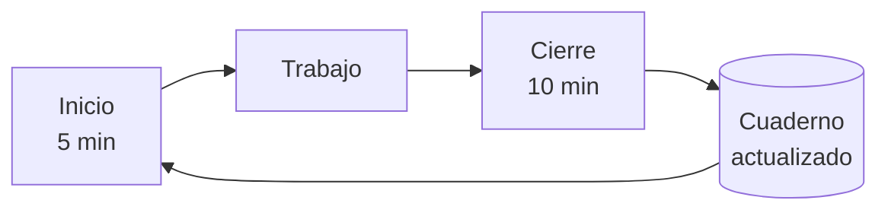

# L0.1.1 · Mapa del curso, niveles 1 y 2, estados de aprendizaje y protocolo de sesión

> 📝 **Borrador.** Todavía no pasó la revisión para publicarse.

## Objetivos

Al terminar esta lección vas a poder:

1. **Ubicar** cualquier lección a partir de su ID (`Lm.u.n`) y decir a qué módulo, unidad, bloque y nivel pertenece, y cómo se verifica.
2. **Distinguir** un prerrequisito duro de uno recomendado y **decidir** si podés empezar un módulo según lo que ya aprobaste.
3. **Explicar** por qué el curso enseña a usar una herramienta (Nivel 1) antes de enseñar a construirla (Nivel 2).
4. **Asignar** el estado correcto a una lección (⬜ 📖 🛠️ ✅ 🔁) según la evidencia disponible.
5. **Aplicar** el protocolo de sesión (inicio, trabajo y cierre) para registrar tu avance en tu cuaderno, con o sin tutor de IA.

## Prerrequisitos

- **Prerrequisitos:** ninguno. Es la primera lección del curso.
- **Requisitos:** un navegador o un editor de texto para leer y editar archivos Markdown (`.md`). Git es opcional en esta lección: se instala en L0.2.1.
- **Costo:** gratis.
- **Tiempo estimado:** 1 h 30 min (unos 45 minutos de lectura y 45 de práctica).
- **Material:** [`PROGRAMA.md`](../../PROGRAMA.md) abierto en otra pestaña y la plantilla [`plantillas/cuaderno-estudiante/`](../../plantillas/cuaderno-estudiante/).

## 1. Conceptos y definiciones

**Programa académico.** El documento [`PROGRAMA.md`](../../PROGRAMA.md) define qué se aprende, en qué orden y cómo se evalúa. Tiene una **versión académica** (por ejemplo, 1.2). Cuando el programa cambia, la versión cambia y se explica cómo adaptar tu registro.

**Jerarquía del curso.**

| Nivel | Qué es | Ejemplo |
|---|---|---|
| Bloque | Grupo de módulos con un propósito común | Bloque I · Fundamentos y uso profesional |
| Módulo | Tema grande, con objetivo, horas, evaluación y, en general, un proyecto | M4 · Agentes de programación: uso guiado |
| Unidad | Subtema dentro de un módulo | U4.2 · Flujo de trabajo profesional |
| Lección | Unidad mínima de estudio, de 1 a 3 horas | L4.2.3 · Instrucciones persistentes |

Además hay **electivas** (E1 a E3), que son especializaciones opcionales, y **proyectos** (P1 a P10), que integran varios módulos.

**ID de lección.** Tiene la forma `Lm.u.n`: módulo `m`, unidad `u`, lección `n`. L4.2.3 es la lección 3 de la unidad 2 del módulo 4. Un ID **nunca se reutiliza**: aunque el programa cambie, un ID siempre se refiere a la misma lección o figura en una tabla de equivalencias.

**Tipo de lección.** Indica cómo se verifica lo aprendido:

- `[C]` **conceptual:** se verifica con preguntas.
- `[P]` **práctica o de herramienta:** se verifica con un ejercicio que funciona y que sabés justificar.
- `[M]` **mixta:** se verifica de las dos formas.

**Prerrequisito duro.** Un conocimiento indispensable: sin él, el módulo no se puede seguir.

**Prerrequisito recomendado.** Un conocimiento que mejora la experiencia, pero no impide empezar. Se puede retomar después.

**Nivel 1 y Nivel 2.** En el Nivel 1 aprendés a **usar y configurar** una herramienta con criterio. En el Nivel 2 aprendés **cómo está construida** y a desarrollar soluciones equivalentes propias.

**Estado de aprendizaje.** La situación de cada lección en tu registro: ⬜ pendiente, 📖 estudiada, 🛠️ practicada, ✅ aprobada o 🔁 necesita refuerzo.

**Evidencia.** Lo que demuestra un estado: una respuesta escrita, un archivo, un *commit*, una captura o la salida de un comando. Sin evidencia, el estado no cambia.

**Cuaderno.** Tus registros privados: progreso, dificultades, respuestas y entregables. Vive en una carpeta **separada** del repositorio del curso.

**Dificultad.** Una brecha de comprensión detectada. Se registra con un ID (`D-001`, `D-002`…) y una severidad, y se trabaja con actividades de refuerzo y **repasos espaciados**: repasos cortos a intervalos crecientes.

**Protocolo de sesión.** Los pasos fijos para empezar, trabajar y cerrar cada sesión de estudio, de modo que la siguiente pueda retomarse sin depender de tu memoria ni de la de un asistente.

## 2. Propósito y casos de uso

**¿Por qué un mapa?** El núcleo del curso tiene 233 lecciones y unas 486 horas, 526 con las electivas. La IA cambia rápido y es fácil saltar de tutorial en tutorial sin construir una base. El mapa te dice qué necesitás antes de cada tema y qué podés hacer en paralelo, y así elegís un recorrido propio sin perder coherencia.

**¿Por qué estados con evidencia?** Leer una explicación clara produce la sensación de haberla entendido. Esa sensación no garantiza que puedas aplicar el concepto: se la suele llamar **ilusión de fluidez**. Separar "lo estudié" (📖) de "lo practiqué" (🛠️) y de "lo demostré" (✅) te protege de esa ilusión.

**¿Por qué un protocolo de sesión?** Con pocas horas por semana, las sesiones están separadas por días. Sin un registro, cada sesión empieza tratando de recordar dónde quedaste. Si estudiás con un asistente de IA, el problema es mayor: el asistente no recuerda conversaciones anteriores de forma confiable (lo vas a entender a fondo en M1 y M3). **Tu cuaderno es la memoria del curso**, no el asistente.

**Casos de uso:**

- Volvés después de tres semanas sin estudiar y necesitás saber exactamente qué sigue.
- Querés adelantar automatización con n8n mientras estudiás otro módulo y tenés que saber si podés.
- Cambiás de asistente de IA (o dejás de usarlo) sin perder el hilo.
- Querés demostrarle a alguien, o a vos misma o mismo, qué sabés hacer y con qué evidencia.

## 3. Explicación paso a paso

### 3.1 Cómo leer el programa

`PROGRAMA.md` tiene 11 secciones. Las que vas a usar todo el tiempo son:

| Sección | Para qué la usás |
|---|---|
| 3 · Mapa de aprendizaje y dependencias | Ver qué módulos dependen de cuáles |
| 4 · Resumen de módulos y horas | Planificar el tiempo |
| 6 · Temario detallado | Ver objetivos, lecciones, ejercicios y criterios de cada módulo |
| 8 · Proyectos | Ver qué construís y qué reutiliza cada proyecto |
| 9 · Evaluación y estados | Saber cuándo una lección o un módulo está aprobado |

**Leer un ID.** Para L4.2.3 buscás "M4" en la sección 6, después la unidad "U4.2" y ahí la lección 3. El tipo aparece entre corchetes (`[P]`). El nivel y el bloque se deducen del módulo: M4 es Nivel 1 y pertenece al Bloque I.

### 3.2 Los bloques

| Bloque | Módulos | Idea central |
|---|---|---|
| I · Fundamentos y uso profesional | M0 a M5 | Cómo funciona un LLM, cómo darle instrucciones y cómo usar con criterio asistentes, agentes de programación y automatizaciones simples |
| II · Construir con modelos | M6 a M8 | API, gestión del contexto y RAG |
| III · Agentes e interoperabilidad | M9 a M12 | Agentes desde cero, MCP, agentes de programación por dentro, skills y plugins |
| IV · Automatización y sistemas avanzados | M13 a M15 | n8n con agentes, frameworks y sistemas multiagente |
| V · Producción e integración | M16 y M17 | Seguridad, evaluación, observabilidad, operación y proyecto final |

### 3.3 Prerrequisitos y rutas

En el diagrama de la sección 3 del programa, una **flecha continua** indica un prerrequisito duro y una **flecha punteada**, uno recomendado. Cada módulo también los enumera en su ficha, en la línea "Prerrequisitos".

**Para decidir si podés empezar un módulo:**

1. Buscá sus prerrequisitos duros.
2. Si todos están aprobados, podés empezar.
3. Si falta un recomendado, igual podés empezar. Anotá en tu cuaderno que conviene retomarlo.
4. Si falta un duro, todavía no.

**Rutas flexibles que permite el programa:**

- M5 (n8n, Nivel 1) solo exige M0: se puede hacer en cualquier momento del Bloque I.
- M3 y M4 se pueden cursar en paralelo después de M2.
- M15 y M16 se pueden cursar en cualquier orden después de M14.
- Una dificultad solo bloquea los módulos que dependen, con prerrequisito duro, del conocimiento afectado.

### 3.4 Nivel 1 y Nivel 2

Para cada herramienta importante, el curso sigue el mismo orden:

| Herramienta | Nivel 1 (usar y configurar) | Nivel 2 (construir y profundizar) |
|---|---|---|
| Asistentes, proyectos y memoria | M3 | M7 |
| Connectors y servidores MCP | M3 | M10 |
| Agentes de programación | M4 | M11 |
| Skills y plugins | M3 y M4 | M11 y M12 |
| Automatización con n8n | M5 | M13 |

**Por qué este orden:**

- **Utilidad temprana.** Al terminar el Bloque I ya usás la IA de forma profesional.
- **Modelo mental antes de construir.** Usar una herramienta te da preguntas concretas ("¿por qué olvidó esto?", "¿por qué me pidió permiso?") que el Nivel 2 responde abriendo la caja.
- **Criterio.** Después de construir tu propio equivalente, podés decidir cuándo conviene la herramienta existente y cuándo una solución propia.

Incluso en el Nivel 1 se explica qué resuelve cada herramienta y cómo funciona conceptualmente. Cada módulo de Nivel 2 empieza con un repaso breve de lo usado en el Nivel 1.

### 3.5 Estados de una lección

| Estado | Significado | Cuándo se alcanza |
|---|---|---|
| ⬜ Pendiente | No empezada | — |
| 📖 Estudiada | Recorriste la lección completa | Leíste o te explicaron la lección de punta a punta. No implica comprensión |
| 🛠️ Practicada | Hiciste la actividad mínima | Hay evidencia de la actividad práctica |
| ✅ Aprobada | La comprensión está verificada | Superaste la verificación según el tipo de lección |
| 🔁 Necesita refuerzo | La verificación de una lección **todavía no aprobada** no se superó | Registraste una dificultad en tu `REFUERZO.md` |

**Verificación según el tipo** (programa, sección 9.2):

| Tipo | Actividad mínima (🛠️) | Verificación (✅) |
|---|---|---|
| `[C]` | Una pregunta de aplicación respondida por escrito | 3 a 5 preguntas con 80% o más de respuestas correctas, incluida al menos una de diagnóstico ("¿por qué pasa X?") |
| `[P]` | El ejercicio hecho, con evidencia | El ejercicio funcionando y justificado: qué hiciste, por qué, alternativas y riesgos |
| `[M]` | Ejercicio o pregunta de aplicación | Las dos verificaciones anteriores |

**Reglas que conviene recordar:**

1. Una lección **nunca** pasa a ✅ solo porque la leíste.
2. Si más adelante aparece una dificultad sobre una lección ya aprobada, la lección **conserva** su ✅, su fecha y su evidencia. Solo se agrega el ID de la dificultad. Vuelve a 🔁 únicamente si se demuestra que su verificación original no era válida.
3. Un **módulo** está aprobado cuando todas sus lecciones están en ✅, la evaluación del módulo alcanza el 80% o más, el proyecto o entregable (si tiene) también, y no queda ninguna dificultad bloqueante abierta que lo afecte.

### 3.6 Dificultades y bloqueos

Cuando una verificación no se supera, o descubrís más tarde un error conceptual, registrás una **dificultad** en tu `REFUERZO.md` con una severidad:

- 🔴 **Bloqueante:** afecta un prerrequisito duro de lo que sigue. Bloquea solo lo que depende de ese conocimiento.
- 🟡 **Importante:** no impide avanzar; se trabaja en paralelo.
- 🟢 **Menor:** un detalle para pulir.

Para superarla hace falta una verificación **distinta** de la que la reveló. Después se programan repasos espaciados (R1, R2, R3) contados en sesiones. El detalle está en la plantilla `REFUERZO.md` del cuaderno.

### 3.7 Protocolo de sesión

**Inicio** (unos 5 minutos):

1. Abrí tu `PROGRESO.md` y mirá "Sesión en curso". Si figura una sesión abierta, la anterior no se cerró: cerrala primero con lo que recuerdes y anotá "cierre tardío".
2. Mirá en tu `REFUERZO.md` si hay repasos pendientes y hacelos primero (5 minutos como máximo).
3. Leé la "Próxima actividad" y confirmá los prerrequisitos si vas a empezar una lección nueva.
4. Anotá "Sesión en curso: Abierta · fecha · lección".

**Trabajo:**

- Estudiá y practicá. Anotá tus dudas en el momento, porque al final se olvidan.
- Guardá la evidencia en tu cuaderno a medida que la producís.

**Cierre** (unos 10 minutos):

1. Actualizá el estado de la lección **solo con evidencia**.
2. Registrá las dificultades nuevas en `REFUERZO.md`.
3. Agregá una fila a la bitácora: fecha, qué hiciste, **horas reales**, cambios de estado y próxima actividad.
4. Dejá "Sesión en curso: Ninguna" y escribí la "Próxima actividad".
5. Si usás Git (desde L0.2.1), confirmá los cambios con un *commit*.

**Registro y sincronización.** Tu cuaderno es la **única fuente de verdad** sobre tu progreso. Si un tutor de IA te propone cambios, vos los aplicás o lo autorizás a aplicarlos. En cualquier caso, comprobás el resultado abriendo el archivo. Una frase como "listo, ya lo guardé" no es evidencia.

## 4. Ejemplos

**Ejemplo 1 · Decidir una ruta.** Ana (persona ficticia) aprobó M0, M1 y M2 y quiere empezar con automatización.

- **M5:** prerrequisito duro M0. Aprobado, así que puede empezar.
- **M13:** prerrequisitos duros M5, M6 y M9. Le faltan los tres, así que todavía no.

Conclusión: puede hacer M5 en paralelo con M3 o M4.

**Ejemplo 2 · Asignar estados.**

| Situación | Estado correcto | Por qué |
|---|---|---|
| Leyó L1.1.1 `[C]` completa | 📖 | Leer no implica comprensión |
| Leyó L1.1.1 y respondió por escrito la pregunta de aplicación | 🛠️ | Hay evidencia de la actividad mínima |
| Respondió 4 de 5 preguntas correctamente, incluida la de diagnóstico | ✅ | 80%: verificación superada |
| Respondió 2 de 5 | 🔁 + dificultad en `REFUERZO.md` | La verificación no se superó |

**Ejemplo 3 · Una fila de bitácora** (datos ficticios):

| Fecha | Lección o actividad | Qué hice | Horas reales | Cambios de estado | Próxima actividad |
|---|---|---|---|---|---|
| 2026-01-15 | L0.1.1 | Lectura y práctica guiada; autoevaluación pendiente | 1,5 | L0.1.1 ⬜ → 🛠️ | Autoevaluación de L0.1.1 |

**Ejemplo 4 · Un tutor bien configurado, sin acceso a tus archivos** (diálogo ficticio):

> **Estudiante:** Terminamos. ¿Actualizás mi progreso?
>
> **Tutor:** No tengo acceso a tus archivos, así que no puedo modificarlos. Te dejo el bloque para pegar en tu `PROGRESO.md`: L0.1.1 pasa a 🛠️ (pregunta de aplicación respondida) y la próxima actividad es la autoevaluación. Cuando lo pegues, revisá que la tabla haya quedado bien.

## 5. Aplicación con herramientas reales

> [!NOTE]
> Específico de herramienta · verificado el 2026-10-12 · fuentes: [Claude Help Center: proyectos](https://support.claude.com/en/articles/9519177) · [OpenAI Help Center: proyectos en ChatGPT](https://help.openai.com/en/articles/10169521-projects-in-chatgpt)

**El cuaderno.** Son archivos Markdown: los podés editar con cualquier editor de texto (por ejemplo VS Code o el Bloc de notas). No necesitás ninguna aplicación especial ni una cuenta.

**Con un tutor de IA,** el protocolo es el mismo, pero cambia quién escribe en el cuaderno según lo que permita la plataforma ([`TUTOR.md`](../../TUTOR.md), sección 3):

| Modo | Ejemplo | Quién actualiza el cuaderno |
|---|---|---|
| A · Acceso a la carpeta | Un agente local abierto en la carpeta del cuaderno | El agente, con tu autorización; después verifica releyendo |
| B · Archivos subidos | Un proyecto de Claude o de ChatGPT con instrucciones y archivos | Vos, con el bloque de actualización que te da el tutor |
| C · Solo chat | Cualquier chat, incluido un modelo local | Vos, con el bloque de actualización |

**Datos verificados para el modo B** (pueden cambiar):

- **Claude:** los proyectos tienen instrucciones y archivos de conocimiento, y están disponibles también para cuentas gratuitas, con un máximo de cinco proyectos. Las conversaciones de un proyecto no comparten contexto entre sí, salvo lo que esté en su conocimiento.
- **ChatGPT:** los proyectos tienen instrucciones y archivos. El plan Free admite hasta 5 archivos por proyecto, y hay una opción de memoria solo del proyecto.

En los dos casos, la **conversación** no es el registro: el registro es tu `PROGRESO.md`.

## 6. Práctica guiada

Con [`PROGRAMA.md`](../../PROGRAMA.md) abierto:

1. **Ubicá L3.5.2.** Anotá su módulo, unidad (con el nombre), tipo, nivel y bloque.
2. **Leé dependencias.** En la sección 3, anotá los prerrequisitos duros y recomendados de M10 y de M13.
3. **Estimá el tiempo del Bloque I.** Sumá las horas de M0 a M5 (sección 4) y calculá cuántas semanas te llevaría con tu dedicación semanal. Agregá un 10% de margen para repasos.
4. **Clasificá situaciones.** Asigná un estado a cada caso:
   - a) Hiciste el ejercicio de una lección `[P]`, funciona, pero todavía no sabés explicar por qué elegiste esa configuración.
   - b) En una lección `[M]` respondiste bien las preguntas y el ejercicio funciona y está justificado.
   - c) En una lección `[C]` respondiste 3 de 5 preguntas.

Comprobá tus resultados en las [soluciones de la práctica guiada](../../soluciones/m00/l0-1-1.md#práctica-guiada).

## 7. Ejercicio independiente

[E0.1.1-a · Armar tu cuaderno y probar el protocolo de sesión](ejercicios/e0-1-1-a-cuaderno.md): creás tu cuaderno privado, definís tu ruta inicial y registrás una sesión completa de punta a punta.

## 8. Autoevaluación

Respondé por escrito en tu cuaderno, **sin mirar las soluciones**. Podés consultar `PROGRAMA.md`.

1. **Ubicar.** ¿Qué indica el ID L11.3.5? ¿A qué nivel y bloque pertenece, y qué hace falta para aprobarla?
2. **Prerrequisitos.** Aprobaste M0, M1 y M2. ¿Cuáles de estos módulos podés empezar: M3, M4, M5, M6? Justificá cada caso.
3. **Estados.**
   - a) En L1.2.1 `[M]` hiciste el ejercicio de tokenización y guardaste la evidencia, pero todavía no respondiste las preguntas. ¿Qué estado corresponde?
   - b) Semanas después de aprobar L1.4.2, descubrís que confundís el límite de salida con el tamaño total de la ventana de contexto. ¿Qué pasa con el estado de L1.4.2 y qué registrás?
4. **Diagnóstico.** Otra persona propone saltear M3 e ir directo a M10 para "aprender MCP de verdad". ¿Lo permite el programa formalmente? ¿Qué argumentos da el curso para hacer primero el Nivel 1?
5. **Diagnóstico.** Estudiás con un asistente de IA en un chat sin acceso a tus archivos. Al cerrar, te dice: "Listo, actualicé tu `PROGRESO.md`". ¿Qué está mal y qué hacés?

**Aprobación:** 4 o más respuestas correctas de 5 (80%). Cada respuesta vale 1 punto. Una respuesta parcial vale 0,5 según la guía de corrección.

**Pregunta de aplicación** (actividad mínima para 🛠️): escribí tu ruta para el Bloque I. Indicá en qué orden vas a hacer M0 a M5, qué vas a hacer en paralelo (si algo), cuántas semanas estimás con tu dedicación y por qué.

Corrección: [respuestas y guía de corrección](../../soluciones/m00/l0-1-1.md#autoevaluación).

## 9. Errores frecuentes

- **Marcar ✅ al terminar de leer.** Leer da 📖. La aprobación necesita una verificación.
- **Tratar un recomendado como duro,** y frenar sin necesidad, o al revés: empezar un módulo sin un prerrequisito duro y trabarse.
- **Saltear el cierre de sesión.** La sesión siguiente empieza sin saber dónde quedaste.
- **Guardar el cuaderno dentro de la carpeta del curso o en un fork público.** Se mezclan o se publican tus datos.
- **Tomar la palabra del tutor como registro.** Solo cuenta lo que está escrito en tu cuaderno y verificaste.
- **Borrar un ✅ al descubrir una dificultad posterior.** La lección conserva su estado. Se agrega la dificultad.
- **Anotar horas estimadas en lugar de reales.** Las horas reales te sirven para planificar mejor.

## 10. Resumen

- El programa se organiza en bloques, módulos, unidades y lecciones. Cada lección tiene un ID estable `Lm.u.n` y un tipo (`[C]`, `[P]`, `[M]`) que define cómo se verifica.
- Los prerrequisitos duros son indispensables; los recomendados no impiden avanzar. Hay rutas en paralelo, como M5 en cualquier momento del Bloque I o M3 y M4 juntos.
- Nivel 1 (usar y configurar) va antes que Nivel 2 (construir), para ganar utilidad temprana, un modelo mental y criterio.
- Los estados ⬜ 📖 🛠️ ✅ 🔁 separan "lo estudié", "lo practiqué" y "lo demostré". Cada cambio necesita evidencia.
- Una dificultad posterior no borra una aprobación: se registra y se trabaja con repasos espaciados.
- Cada sesión tiene inicio, trabajo y cierre. Tu cuaderno es la única fuente de verdad sobre tu progreso, con o sin tutor de IA.

## 11. Referencias

- [`PROGRAMA.md`](../../PROGRAMA.md): secciones 2 (niveles), 3 (mapa), 4 (horas), 6 (temario) y 9 (evaluación y estados).
- [`COMO-EMPEZAR.md`](../../COMO-EMPEZAR.md) y [`TUTOR.md`](../../TUTOR.md).
- Plantillas del cuaderno: [`plantillas/cuaderno-estudiante/`](../../plantillas/cuaderno-estudiante/).
- Fuentes de la sección 5: [Claude Help Center: proyectos](https://support.claude.com/en/articles/9519177) y [OpenAI Help Center: proyectos en ChatGPT](https://help.openai.com/en/articles/10169521-projects-in-chatgpt), consultadas el 2026-10-12.

## Términos nuevos

Agregados a [`GLOSARIO.md`](../../GLOSARIO.md), sección "Términos del curso": programa académico, ID de lección, prerrequisito duro y recomendado, Nivel 1 / Nivel 2, estado de aprendizaje, evidencia, cuaderno, protocolo de sesión, dificultad y repaso espaciado.

## Registrar en tu cuaderno

| Situación | Estado de L0.1.1 | Evidencia |
|---|---|---|
| Leíste la lección | 📖 | — |
| Escribiste la pregunta de aplicación (tu ruta) | 🛠️ | El archivo con tu ruta |
| Obtuviste 4 de 5 o más en la autoevaluación | ✅ | Tus respuestas y la corrección |
| Obtuviste menos de 4 | 🔁 | Registrá la dificultad en `REFUERZO.md` |
